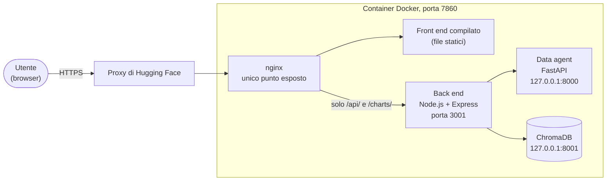

# ScoutEdge Analytics — assistente AI ibrido

Assistente conversazionale per il reparto Data Science & Client Success di **ScoutEdge Analytics**, un'azienda immaginaria che vende software di scouting e performance analytics ai club di calcio. L'utente scrive una domanda in italiano e un agente AI decide da solo come rispondere: cercando nel manuale interno dell'azienda oppure facendo analizzare il dataset delle osservazioni di scouting da un servizio Python, con tanto di grafici.

È il progetto finale del master universitario "AI e Agenti AI per il Business" (Start2Impact / UniMarconi).

**Demo online:** <https://francodesc-scoutedge-analytics.hf.space>

La demo gira su un servizio che va in pausa dopo 48 ore senza visite: se è ferma, la prima apertura richiede circa 30 secondi. Come è costruita e come si pubblica: [Demo online e deploy](#demo-online-e-deploy).

Una presentazione di 15 slide, con scenario, architettura, esempi di conversazione, sfide, test e limiti, è in [`docs/ScoutEdge_Analytics_presentazione.pdf`](docs/ScoutEdge_Analytics_presentazione.pdf).

## Lo scenario

Le persone del reparto hanno due problemi diversi, che di solito richiedono due strumenti diversi:

- **Trovare informazioni nei documenti.** Piani di abbonamento, metodologia di calcolo del rating, procedura di data cleaning, SLA e escalation, FAQ: tutto è nel manuale interno, e cercarlo a mano fa perdere tempo.
- **Estrarre numeri dai dati.** Medie, classifiche, andamenti per stagione, valori di mercato: le osservazioni dei giocatori sono in un file CSV con anomalie vere (duplicati, club scritti in decine di modi diversi, date in formati misti), che va prima ripulito.

L'assistente li risolve da un'unica chat. Per ogni domanda, un modello linguistico sceglie tra tre strade:

| La domanda riguarda… | Strada scelta | Esempio |
|---|---|---|
| regole, procedure, definizioni, metodologia | **RAG** sul manuale (ChromaDB) | "Qual è il tempo di prima risposta per priorità alta?" |
| numeri, classifiche, andamenti, grafici | **Data agent** Python sul dataset | "Qual è lo scout_rating medio per stagione?" |
| entrambe le cose | prima il manuale, poi i dati | "Secondo la metodologia, quali metriche contano per i difensori? Poi mostrami i migliori" |

Se la domanda non c'entra con ScoutEdge, l'assistente lo dice e non chiama nessuno strumento.

## Architettura


Quattro servizi, ciascuno nella sua cartella:

| Servizio | Cartella | Tecnologie | Porta |
|---|---|---|---|
| Front end | `front end/` | React 19, Vite 8, Tailwind CSS 4 | 5173 |
| Back end (orchestratore) | `back end/` | Node.js, Express 5, LangChain.js | 3001 |
| Data agent | `data_agent/` | Python, FastAPI, pandas, matplotlib, LangChain | 8000 |
| Database vettoriale | (container Docker) | ChromaDB | 8001 |

Come lavorano insieme:

- **Il browser parla solo con il back end.** Mai direttamente con il data agent né con Chroma: i grafici passano dal back end, che li riespone.
- **L'LLM è lo snodo decisionale.** Il back end gestisce la conversazione e passa al modello (`gpt-4o-mini`) due strumenti con la tecnica del *function calling*: `search_handbook` e `analyze_data`. Il modello ragiona sulla domanda e sceglie quale chiamare, in un ciclo ReAct scritto a mano. Il comportamento è descritto in [`docs/DESIGN_ORCHESTRATORE.md`](docs/DESIGN_ORCHESTRATORE.md).
- **Il RAG** usa ChromaDB con embedding OpenAI `text-embedding-3-small`: il manuale è diviso in 18 passaggi e solo quelli sufficientemente vicini alla domanda vengono passati al modello.
- **Il data agent** pulisce il CSV all'avvio, poi, per ogni richiesta, un agente scrive ed esegue codice Python (pandas, matplotlib) sui dati e restituisce un testo di sintesi e, se serve, un grafico in PNG.
- **La memoria della conversazione** vive nel back end: ogni conversazione ha un identificatore di sessione, con gli ultimi 20 messaggi e una scadenza di 30 minuti di inattività.

Questo è lo schema dell'avvio in locale, con quattro processi separati. Nella demo online gli stessi servizi girano in un solo container, dietro nginx: vedi [Demo online e deploy](#demo-online-e-deploy).

## Funzionalità

- Chat in italiano con memoria: "e nella stagione precedente?" o "e per i portieri?" si capiscono dal contesto.
- Risposte formattate in Markdown (elenchi, tabelle, grassetto).
- Grafici generati al volo dal data agent, mostrati nella risposta e, su schermi larghi (da 1024 px), in un pannello laterale con "Ingrandisci" e "Scarica". Il grafico del pannello si ingrandisce anche con un clic.
- Etichette sotto ogni risposta che mostrano da dove arriva: `📄 Handbook — <sezione>` per ogni sezione del manuale citata, `📊 Analisi dati`, oppure `📄 Handbook (nessuna sezione citata)` quando il manuale è stato consultato ma non c'è nessuna sezione da citare (nessun passaggio abbastanza pertinente, oppure Chroma non raggiungibile).
- Quattro schede di esempio nella schermata iniziale: un clic invia la domanda.
- Pulsante "Note" in alto: apre la finestra "Note sul progetto", con una breve descrizione del progetto, dell'architettura e dei limiti, e l'autore.
- Indicatore di attesa durante l'elaborazione, con un avviso dopo 10 secondi se la risposta tarda; avviso se si è offline.
- Errori mostrati in chat con un messaggio comprensibile e, quando ritentare ha senso, il pulsante "Riprova".
- "Nuova chat" per azzerare la conversazione.
- Se uno dei servizi non è disponibile, l'assistente lo dichiara e non inventa numeri né contenuti del manuale.

### Domande di esempio

Quattro domande che mostrano le diverse strade. I risultati attesi sono in [`docs/TEST.md`](docs/TEST.md).

| # | Domanda | Cosa mostra |
|---|---|---|
| 1 | *Qual è il tempo di prima risposta per una richiesta ad alta priorità?* | Solo RAG: risposta dal manuale (sezione 7), etichetta `📄 Handbook — 7. SLA e procedura di supporto` |
| 2 | *Quali sono i 10 giocatori con il valore di mercato attuale più alto? Mostrami anche un grafico.* | Solo data agent: analisi del dataset e grafico, etichetta `📊 Analisi dati` |
| 3 | *Secondo la metodologia, quali metriche contano di più per i difensori centrali? Poi mostrami i 3 CB con il duels_won_pct attuale più alto.* | Entrambi gli strumenti, in sequenza: prima il manuale, poi i dati |
| 4 | *Qual è lo scout_rating medio nell'ultima stagione?* seguita da *E nella stagione precedente?* | Memoria della conversazione: la seconda domanda si capisce solo con la prima |

## Dati e knowledge base

L'agente lavora su due fonti, entrambe nella cartella `data/` e costruite per essere coerenti tra loro e con lo scenario.

### Dataset: `data/scouting_data.csv`

Osservazioni di scouting su giocatori di club immaginari: 35 colonne tra anagrafica, statistiche di gara, valore di mercato, scadenza del contratto, `scout_rating`, giorni di infortunio, data dell'osservazione e scout. La chiave dei giocatori è sempre `player_id`, mai il nome (ci sono omonimi).

| | Prima della pulizia | Dopo la pulizia |
|---|---|---|
| Righe | 1208 | 1185 |
| Giocatori | | 130 |
| Club | 74 grafie diverse | 25 |
| Nazionalità | 45 grafie diverse | 24 |
| Stagioni | | 3 (2023/24, 2024/25, 2025/26) |

Il file contiene volutamente dati "sporchi": 23 righe duplicate, club e nazionalità scritti in modi diversi (maiuscole, spazi), date e valori di mercato in formati misti, nomi di giocatori giapponesi in kanji, titoli e qualifiche nei nomi di alcuni giocatori (per esempio "Dr.", "Herr", "MBA"), che la pulizia toglie. Ci sono anche coppie di osservazioni dello stesso giocatore nello stesso giorno: non sono duplicati, ma valutazioni distinte, e l'agente le segnala quando incidono su una risposta.

La pulizia è **deterministica**, non affidata all'LLM: `data_agent/cleaning.py` la esegue una sola volta all'avvio del data agent e si ferma con un errore se i controlli finali non tornano. L'agente riceve il riepilogo delle correzioni, quindi sa rispondere anche a "quali correzioni avete applicato ai dati?".

### Knowledge base: `data/platform_handbook.md`

Il manuale interno del reparto (versione 1.7, circa 2500 parole, 8 sezioni): chi siamo, piani di abbonamento, metodologia di scouting, glossario delle metriche, policy dati e privacy, procedura di data cleaning, SLA e procedura di supporto, FAQ del Client Success. Viene indicizzato in ChromaDB in 18 passaggi (sezioni intere; la sezione 3 divisa per sottosezione, la 8 per domanda).

Manuale, dataset e interfaccia sono tenuti allineati tra loro. La procedura di data cleaning descritta nella sezione 6 è quella che `cleaning.py` implementa, e il glossario spiega le metriche che compaiono davvero nelle colonne del CSV. Il file [`docs/CHANGELOG_HANDBOOK.md`](docs/CHANGELOG_HANDBOOK.md) tiene la storia di queste scelte. Per esempio, nella versione 1.6 è stata tolta una guida alla dashboard perché citava funzioni (Shortlist, Confronto Giocatori, Report Custom) che l'interfaccia consegnata non ha: il retrieval le avrebbe attribuite a un prodotto che non c'è. Nella 1.3 lo storico delle stagioni è stato allineato a quello del dataset.

## Stack e versioni

| Livello | Tecnologie |
|---|---|
| Front end | React 19, Vite 8, Tailwind CSS 4, `react-markdown` con `remark-gfm` |
| Back end | Node.js (moduli ESM), Express 5, LangChain.js 1.x (`@langchain/core`, `@langchain/openai`), client `chromadb` 3.x, `zod` 4, `express-rate-limit` 8 |
| Data agent | Python 3.13, FastAPI, uvicorn, pandas 3, matplotlib e seaborn, LangChain 1.x con LangGraph |
| Database vettoriale | ChromaDB 1.4.4 (immagine Docker `chromadb/chroma`, fissata con il digest), distanza coseno |
| Modelli OpenAI | `gpt-4o-mini` (orchestratore e data agent), `text-embedding-3-small` (embedding) |
| Deploy | Docker (immagine in tre fasi: `node:24-trixie-slim`, `chromadb/chroma` fissata con il digest, `python:3.13-slim-trixie`), nginx (pacchetto di Debian trixie), Hugging Face Spaces |

Le versioni esatte sono in `back end/package.json`, `front end/package.json` e `data_agent/requirements.txt`. Nel back end non c'è il pacchetto generico `langchain`: il ciclo ReAct di scelta degli strumenti è scritto a mano, per tenerne sotto controllo ogni passo (vedi [`docs/DESIGN_ORCHESTRATORE.md`](docs/DESIGN_ORCHESTRATORE.md)).

## Prerequisiti

- **Node.js** 20.19 o successivo (oppure 22.12 o successivo), con npm. Lo richiede Vite 8.
- **Python 3.13**, con il modulo `venv`. Su macOS il comando `python3` di sistema è una versione più vecchia (la 3.9), troppo vecchia per questo progetto: pandas 3 richiede almeno la 3.11. Python 3.13 si installa dal sito python.org (installer per macOS) oppure con Homebrew (`brew install python@3.13`): entrambi forniscono il comando `python3.13`.
- **Docker**, per eseguire ChromaDB. È l'unico modo supportato per avviarlo.
- **Una chiave API OpenAI** con accesso a `gpt-4o-mini` e a `text-embedding-3-small`.
- **Porte libere**: 5173, 3001, 8000 e 8001.
- **Git**, per clonare il repository.

I comandi di questo README sono scritti per macOS e Linux, e sono stati provati su macOS. Per Windows c'è la sezione [Su Windows (PowerShell)](#su-windows-powershell), con i comandi equivalenti: non è stata provata su Windows.

**Sui costi.** Ogni domanda genera alcune chiamate a `gpt-4o-mini` (una per l'orchestratore, di più se interviene il data agent), e l'indicizzazione del manuale usa gli embedding. Con questi modelli il costo è contenuto, ma non nullo, e la suite di test completa fa decine di richieste. Conviene usare una chiave con un limite di spesa.

## Installazione

I tre ambienti (back end, front end, data agent) si installano separatamente. Tutti i comandi partono dalla radice del repository.

```bash
git clone https://github.com/FranCodesc/scoutedge-analytics.git
cd scoutedge-analytics
```

**Back end** (le cartelle `back end/` e `front end/` hanno uno spazio nel nome: servono le virgolette):

```bash
cd "back end"
npm install
cp .env.example .env
cd ..
```

**Front end:**

```bash
cd "front end"
npm install
cp .env.example .env
cd ..
```

**Data agent** (Python 3.13, in un ambiente virtuale). L'installazione delle dipendenze può richiedere qualche minuto:

```bash
cd data_agent
python3.13 -m venv venv
source venv/bin/activate
pip install -r requirements.txt
cp .env.example .env
deactivate
cd ..
```

Prima di creare il `venv`, controlla la versione: `python3.13 --version` deve rispondere 3.13.x. Se il comando `python3.13` non esiste, Python 3.13 non è installato (vedi i [Prerequisiti](#prerequisiti)): `python3` da solo, su macOS, è la versione di sistema e non va bene. Se Python 3.13 arriva da Anaconda o Miniconda, puoi usare il percorso completo dell'interprete, per esempio `/opt/anaconda3/bin/python3.13 -m venv venv`. Dopo `source venv/bin/activate`, anche `python --version` deve rispondere 3.13.x.

Se usi conda, esegui `conda deactivate` prima di creare e attivare il `venv`: con due ambienti attivi insieme `python` e `pip` possono puntare a quello sbagliato.

## Configurazione dei file `.env`

Ogni ambiente ha un file `.env.example` da copiare in `.env` (i comandi sopra lo fanno già). I valori di esempio vanno bene per l'avvio in locale: **serve solo inserire la chiave OpenAI**. I file `.env` contengono segreti, sono esclusi da git e non vanno mai committati.

| File | Variabile | Valore di esempio | Note |
|---|---|---|---|
| `back end/.env` | `OPENAI_API_KEY` | *(la tua chiave)* | Obbligatoria: embedding della RAG e LLM dell'orchestratore |
| | `PORT` | `3001` | Porta del back end |
| | `DATA_AGENT_URL` | `http://127.0.0.1:8000` | Il protocollo (`http://`) è obbligatorio |
| | `CHROMA_URL` | `http://localhost:8001` | Il protocollo è obbligatorio |
| | `FRONTEND_ORIGIN` | `http://localhost:5173` | Origine ammessa dalla CORS |
| | `RATE_LIMIT_WINDOW_MIN` | *(assente)* | Facoltativa. Finestra del limite di frequenza su `POST /api/chat`, in minuti (massimo 1440). Demo online: `15` |
| | `RATE_LIMIT_PER_IP` | *(assente)* | Facoltativa. Richieste per IP nella finestra. Demo online: `20` |
| | `RATE_LIMIT_GLOBAL` | *(assente)* | Facoltativa. Richieste totali nella finestra, da tutti i client. Demo online: `100` |
| | `TRUST_PROXY` | *(assente)* | Facoltativa. Numero di proxy davanti al back end (intero ≥ 0). Demo online: `2`. Vedi [`TRUST_PROXY`](#trust_proxy-come-è-stato-ricavato) |
| `data_agent/.env` | `OPENAI_API_KEY` | *(la tua chiave)* | Obbligatoria: modello che scrive il codice di analisi |
| `front end/.env` | `VITE_API_URL` | `http://localhost:3001` | URL del back end. Le variabili `VITE_` finiscono nel browser: qui non vanno mai chiavi |

La stessa chiave può stare nei due file che la richiedono.

Le tre variabili `RATE_LIMIT_*` vanno impostate **tutte o nessuna**: se ne manca una, o il valore non è un intero positivo, il back end non parte. Senza di esse il limite di frequenza è disattivato, ed è il comportamento in locale. Nel container della demo online, invece, tutte e quattro le variabili sono obbligatorie: lo script di avvio si rifiuta di partire se ne manca una.

## Chroma e indicizzazione del manuale

ChromaDB si esegue con **Docker**, che è l'unico modo supportato e provato. Con Docker avviato, da `back end/`:

```bash
cd "back end"
docker run -d --name chroma-scoutedge -p 127.0.0.1:8001:8000 -v "$(pwd)/chroma_data:/data" chromadb/chroma@sha256:1e0b73a187a28757c572acba508c46f48c9e8b0acaf5c20e6d95cdedce1acdf6
npm run ingest
cd ..
```

L'immagine è fissata con il digest (Chroma 1.4.4, la versione su cui il progetto è stato provato) perché il tag `latest` cambia nel tempo e una versione diversa potrebbe non essere compatibile con il client `chromadb` del back end.

- Il container espone Chroma sulla porta 8001 e salva i dati in `back end/chroma_data/`, una cartella esclusa da git. Chroma 1.x scrive in `/data` dentro il container, per questo il mount punta lì.
- La porta è pubblicata come `127.0.0.1:8001`, non come semplice `8001`: senza l'indirizzo davanti Docker la apre su tutte le interfacce, e Chroma, che qui non ha autenticazione, sarebbe raggiungibile da chiunque sia sulla stessa rete. Il back end gira sullo stesso computer e usa `localhost`, quindi non cambia nulla per l'avvio.
- `npm run ingest` legge `data/platform_handbook.md`, ne calcola gli embedding con OpenAI e li scrive nella collection `platform-handbook`. Alla fine stampa `Chunk nella collection "platform-handbook": 18`.
- L'ingestione si può rilanciare in sicurezza: aggiorna i passaggi esistenti e rimuove quelli che non esistono più nel manuale.
- Se il container esiste già (errore "name already in use"), non ricrearlo: `docker start chroma-scoutedge`. Dopo un riavvio del computer si fa lo stesso: i dati indicizzati restano.

## Avvio

Servono quattro terminali (Chroma gira già in background con Docker). L'ordine conta: ogni servizio ne usa uno di quelli sopra. Tutti i comandi partono dalla radice del repository.

**1. Chroma.** Se hai appena eseguito `docker run`, è già attivo. Dopo un riavvio del computer:

```bash
docker start chroma-scoutedge
```

**2. Data agent** (primo terminale). Aspetta il messaggio `Data agent pronto`:

```bash
cd data_agent
source venv/bin/activate
uvicorn main:app --reload
```

Uvicorn ascolta solo su `127.0.0.1` (il comportamento predefinito): non aggiungere `--host 0.0.0.0`. Il data agent esegue codice generato dall'LLM e non deve essere raggiungibile dalla rete (vedi [Sicurezza e limiti noti](#sicurezza-e-limiti-noti)).

**3. Back end** (secondo terminale). Aspetta `Back end in ascolto su http://localhost:3001`:

```bash
cd "back end"
npm run dev
```

**4. Front end** (terzo terminale):

```bash
cd "front end"
npm run dev
```

Apri <http://localhost:5173>. All'avvio compare una breve schermata introduttiva di circa 3 secondi, poi la chat con le domande di esempio.

Per verificare che i servizi rispondano, da un altro terminale:

```bash
curl http://127.0.0.1:8000/     # data agent → {"status":"ok"}
curl http://localhost:3001/     # back end   → {"status":"ok"}
```

Le analisi sui dati possono richiedere fino a un minuto (il modello scrive ed esegue codice): l'interfaccia lo segnala dopo 10 secondi di attesa.

Per fermare tutto: `Ctrl+C` in ciascun terminale e `docker stop chroma-scoutedge`.

## Su Windows (PowerShell)

I comandi di questo README sono stati provati solo su macOS. Quelli qui sotto sono gli equivalenti per Windows 10 e 11 con PowerShell, ma **non sono stati provati su Windows**: se qualcosa non torna, fa fede il messaggio di errore.

Servono gli stessi prerequisiti (Node.js, Python 3.13, Git, chiave OpenAI) e **Docker Desktop con il backend WSL 2**, che è l'impostazione predefinita dell'installer. Il comando `py` (installato con Python da python.org) sceglie la versione con `py -3.13`.

| Passo | macOS / Linux | Windows (PowerShell) |
|---|---|---|
| Creare il `venv` | `python3.13 -m venv venv` | `py -3.13 -m venv venv` |
| Attivare il `venv` | `source venv/bin/activate` | `.\venv\Scripts\Activate.ps1` |
| Copiare i file `.env` | `cp .env.example .env` | `Copy-Item .env.example .env` |
| Cartella corrente nel volume di Docker | `-v "$(pwd)/chroma_data:/data"` | `-v "${PWD}/chroma_data:/data"` |
| Controllare i servizi | `curl http://localhost:3001/` | `curl.exe http://localhost:3001/` |
| Variabile d'ambiente per un comando | `RIPETI=3 python scripts/regression_check.py "giocatore 33"` | `$env:RIPETI=3; python scripts/regression_check.py "giocatore 33"` |
| Processo che occupa una porta | `lsof -i :3001` | `netstat -ano \| findstr :3001` |

Il comando di Chroma, da `back end/`:

```powershell
docker run -d --name chroma-scoutedge -p 127.0.0.1:8001:8000 -v "${PWD}/chroma_data:/data" chromadb/chroma@sha256:1e0b73a187a28757c572acba508c46f48c9e8b0acaf5c20e6d95cdedce1acdf6
```

Note:

- Se PowerShell rifiuta `Activate.ps1` perché l'esecuzione di script è disabilitata, esegui una volta `Set-ExecutionPolicy -Scope CurrentUser RemoteSigned` e riprova.
- In PowerShell `curl` è un alias di `Invoke-WebRequest`: per i comandi del README serve `curl.exe`.
- `${PWD}` va scritto con le graffe, altrimenti PowerShell legge male il percorso davanti ai due punti.
- `$env:RIPETI` resta impostata finché la finestra è aperta; per toglierla: `Remove-Item Env:RIPETI`.
- Tutto il resto (`npm`, `uvicorn`, `docker start`, `docker stop`, `npm run ingest`) è identico. Lo stesso vale per i comandi di [`docs/TEST.md`](docs/TEST.md), con le stesse traduzioni.

In alternativa si può usare **WSL 2** con una distribuzione Linux (per esempio Ubuntu): i comandi Linux di questo README valgono così come sono. Il repository va clonato dentro il file system di WSL (non sotto `/mnt/c`, che è lento), Node.js e Python 3.13 vanno installati dentro la distribuzione, e in Docker Desktop va attivata l'integrazione con WSL.

## Test

Con Chroma, data agent e back end avviati, da `back end/`:

```bash
cd "back end"
npm run test:api -- --solo-a    # solo i controlli automatici del contratto
npm run test:api                # controlli automatici + domande da valutare a mano
```

La parte automatica esegue 23 controlli (validazione degli input, codici di errore, sessioni, catena dei grafici) e deve chiudersi con **23 OK, 0 KO**. La seconda parte pone le domande del design attraverso l'API, e le risposte si confrontano a mano con i valori attesi. Le richieste chiamano OpenAI, quindi hanno un costo.

Le verifiche che richiedono di spegnere servizi, i valori attesi e le distanze di retrieval sono in [`docs/TEST.md`](docs/TEST.md).

Il data agent ha due script di prova in `data_agent/scripts/` (traccia di una domanda e regressione), descritti in [`docs/TEST.md`](docs/TEST.md#script-di-test-del-data-agent). L'esito della prova end-to-end dall'interfaccia è in [`docs/TEST.md`](docs/TEST.md#esito-della-prova-end-to-end-18-ottobre-2026).

## Demo online e deploy

La demo è pubblica all'indirizzo <https://francodesc-scoutedge-analytics.hf.space>, su uno Space Docker di Hugging Face. Esegue lo stesso codice del repository, impacchettato in un unico container.

Lo Space va in pausa dopo 48 ore senza visite. Alla prima apertura dopo una pausa la demo riparte in circa 30 secondi. Le conversazioni e i grafici generati non sopravvivono al riavvio: le sessioni stanno in memoria e il manuale viene indicizzato di nuovo a ogni avvio.

### Architettura del container



- **nginx è l'unico processo raggiungibile dall'esterno** (porta 7860). Serve il front end già compilato e inoltra al back end solo `/api/` e `/charts/`. Tutto il resto dà 404, compreso il controllo di stato `GET /` del back end.
- Il back end ascolta sulla porta 3001 di tutte le interfacce del container, ma la porta non è pubblicata: si raggiunge solo tramite nginx. Data agent e Chroma ascoltano solo su `127.0.0.1`.
- Cinque processi, avviati da `deploy/start.sh` nell'ordine in cui dipendono l'uno dall'altro: Chroma, indicizzazione del manuale (18 passaggi), data agent, back end, nginx. Lo script aspetta ogni servizio fino a 120 secondi e, se uno si ferma, chiude il container con un codice diverso da 0, così la piattaforma lo riavvia.
- Il container gira con un utente non root (UID 1000). Il codice appartiene a root e l'utente può scrivere solo nella cartella dei grafici e in `/tmp`, dove stanno i dati di Chroma.
- Nell'immagine non c'è nessun segreto: i file `.env` sono esclusi da `.dockerignore`, e la chiave e le altre variabili si passano all'avvio.
- L'immagine occupa 1,96 GB su disco (406 MB compressi) e il container usa tra 212 e 256 MB di memoria.

### Avvio in locale con Docker

Serve solo Docker. Non servono Node.js né Python, e nemmeno gli altri servizi di questo README.

**1. File di variabili**, **fuori dal repository** (per esempio nella cartella home), con un nome come `scoutedge-container.env`. Una variabile per riga, senza virgolette:

```text
OPENAI_API_KEY=<la tua chiave>
FRONTEND_ORIGIN=http://localhost:7860
RATE_LIMIT_WINDOW_MIN=15
RATE_LIMIT_PER_IP=20
RATE_LIMIT_GLOBAL=100
TRUST_PROXY=1
```

Sono le sei variabili che lo script di avvio richiede: se ne manca una, il container si ferma subito e dice quale (senza mai stamparne il valore). In locale c'è un solo proxy davanti al back end, nginx, per questo `TRUST_PROXY` è `1`.

**2. Build**, dalla radice del repository. `VITE_API_URL` è l'indirizzo con cui il browser raggiunge il back end e Vite lo incorpora nel codice al momento della build. Non ha un valore predefinito: senza l'argomento la build si ferma con `Manca --build-arg VITE_API_URL`.

```bash
docker build --build-arg VITE_API_URL=http://localhost:7860 -t scoutedge .
```

**3. Avvio.** La porta è pubblicata solo su `127.0.0.1`:

```bash
docker run --rm --name scoutedge -p 127.0.0.1:7860:7860 --env-file ~/scoutedge-container.env scoutedge
```

Quando il log mostra `[avvio] Tutti i servizi sono attivi.` (circa 20 secondi), apri <http://localhost:7860>. Usa esattamente questo indirizzo, lo stesso della build: con `127.0.0.1` al posto di `localhost` il browser lo tratterebbe come un'origine diversa e la CORS bloccherebbe le richieste. Per cambiare indirizzo, rifai la build con un altro `VITE_API_URL` e aggiorna `FRONTEND_ORIGIN`. Per fermare: `Ctrl+C`, oppure `docker stop scoutedge` da un altro terminale.

Per provare il limite di frequenza in locale basta abbassare i valori nel file (per esempio `RATE_LIMIT_PER_IP=3`). Le prove fatte sono in [`docs/TEST.md`](docs/TEST.md#prove-del-limite-di-frequenza-in-locale).

### Pubblicazione su Hugging Face

**Prerequisiti.** Un account Hugging Face con il piano PRO (vedi [Scelta della piattaforma](#scelta-della-piattaforma)), lo strumento `hf` (`pip install -U huggingface_hub`) e l'accesso già effettuato con `hf auth login`, meglio con un token a granularità fine limitato allo Space. Lo Space è di tipo Docker, creato dall'interfaccia web (nella demo: `FranCodesc/scoutedge-analytics`, CPU basic, pubblico).

**Secret e variabili dello Space** (scheda *Settings* → *Variables and secrets*):

| Tipo | Nome | Valore |
|---|---|---|
| Secret | `OPENAI_API_KEY` | una chiave OpenAI dedicata alla demo, con un tetto di spesa mensile |
| Variabile | `VITE_API_URL` | l'URL pubblico dello Space (arriva alla build come argomento, perché il `Dockerfile` lo dichiara con `ARG`) |
| Variabile | `FRONTEND_ORIGIN` | l'URL pubblico dello Space |
| Variabili | `RATE_LIMIT_WINDOW_MIN`, `RATE_LIMIT_PER_IP`, `RATE_LIMIT_GLOBAL` | `15`, `20`, `100` |
| Variabile | `TRUST_PROXY` | `2` |

Le variabili di uno Space sono pubbliche: per questo la chiave sta tra i secret e nelle variabili ci sono solo valori che non sono segreti.

**Caricamento.** Prima si pubblica il commit su GitHub, poi lo si carica sullo Space, così i due restano allo stesso commit:

```bash
git push
deploy/upload_space.sh FranCodesc/scoutedge-analytics --prova   # elenca i file, non carica nulla
deploy/upload_space.sh FranCodesc/scoutedge-analytics           # carica
```

Lo script:

- parte da `git archive HEAD`, quindi carica **solo i file committati**: `.env`, `venv/`, `node_modules/` e le modifiche non ancora committate non possono finire sullo Space (se ci sono modifiche non committate, lo script avvisa);
- sostituisce il `README.md` del repository con `deploy/README_SPACE.md`, che ha l'intestazione di configurazione che lo Space legge (SDK Docker, porta 7860);
- si rifiuta di caricare se l'esportazione contiene file vietati (`.env*` tranne `.env.example`, `venv`, `node_modules`, `chroma_data`, `.git`);
- usa `hf upload`, che aggiunge e sovrascrive file ma **non cancella** sullo Space quelli tolti dal repository: vanno rimossi a mano.

Dopo il caricamento lo Space ricostruisce l'immagine (circa 1 minuto) e riavvia il container.

### `TRUST_PROXY`: come è stato ricavato

Il limite di frequenza per IP funziona solo se il back end conosce l'IP vero di chi scrive. Dietro una catena di proxy l'IP sta nell'intestazione `X-Forwarded-For`, e `TRUST_PROXY` dice a Express quanti proxy della catena sono fidati. Un valore sbagliato si sbaglia in due modi: troppo basso e il limite vede solo indirizzi dei proxy; troppo alto e ci si fida di un'intestazione che il client può scrivere da solo.

Online la catena è: proxy di Hugging Face, poi nginx, poi back end. Il valore si è ricavato provando, non assumendolo:

- con `TRUST_PROXY=1` il limite vedeva indirizzi interni di Hugging Face (`10.20.x.x`), diversi a ogni richiesta: ogni richiesta contava come un client nuovo;
- con `TRUST_PROXY=2` il limite vede l'IP pubblico del computer da cui si provava;
- **prova di falsificazione:** inviando una richiesta con l'intestazione `X-Forwarded-For: 1.2.3.4` scritta a mano, l'indirizzo falsificato viene ignorato: resta più a sinistra nella catena e non è quello usato per il limite.

Senza `TRUST_PROXY` il back end ignora del tutto `X-Forwarded-For`. Il numero giusto dipende dalla piattaforma: su un altro servizio va ricavato di nuovo con la stessa prova.

### Scelta della piattaforma

Il progetto è stato pubblicato su uno **Space Docker di Hugging Face**, che dall'8 luglio 2026 richiede il piano PRO (9 $/mese).

- **Situazione piattaforme di deploy.** Alla data della scelta (25 ottobre 2026) le condizioni delle piattaforme sono state controllate: gli Space Docker erano passati a pagamento, mentre i piani gratuiti di altri servizi (Render, Koyeb, Railway) offrono 256–512 MB di memoria e poca CPU.
- **Memoria misurata.** Il container in funzione usa tra 212 e 256 MB: con un limite di 256 MB non c'è margine, con 512 MB sì.
- **Risorse di un piano gratuito simulate in locale.** Prima della scelta definitiva è stato simulato un piano gratuito (Render) con `docker run --cpus=0.1 --memory=512m`, con una regola di decisione fissata prima della prova. L'avvio è durato **2 minuti e 29 secondi**: Chroma 1,7 s, indicizzazione del manuale 28 s, data agent 91 s, back end 28 s, nginx 0,5 s. Dei 91 secondi del data agent, 79 servono solo a caricare Python e le sue librerie: il collo di bottiglia è la CPU, non il codice. Piano gratuito scartato. Sullo Space (2 CPU) lo stesso container è pronto in circa 20 secondi.
- **Il container non dipende dalla piattaforma.** Qualunque servizio che esegue un container Docker e permette di impostare variabili d'ambiente può ospitarlo: le variabili sono quelle della tabella sopra, e va ricavato di nuovo `TRUST_PROXY`.

Le misure e le prove online sono in [`docs/TEST.md`](docs/TEST.md#simulazione-con-risorse-ridotte) e [`docs/TEST.md`](docs/TEST.md#prove-online-26-ottobre-2026).

## Struttura del repository

```text
.
├── README.md
├── Dockerfile                     container unico della demo online
├── .dockerignore                  file esclusi dall'immagine
├── deploy/
│   ├── nginx.conf                 nginx: unico punto esposto del container
│   ├── start.sh                   avvio dei servizi nel container
│   ├── upload_space.sh            caricamento dei file committati sullo Space
│   └── README_SPACE.md            README dello Space (con la sua intestazione)
├── data/
│   ├── scouting_data.csv          dataset delle osservazioni di scouting
│   └── platform_handbook.md       manuale interno (knowledge base del RAG)
├── docs/
│   ├── CONTRATTO_API.md           contratto tra front end e back end
│   ├── DESIGN_ORCHESTRATORE.md    design e prompt dell'orchestratore
│   ├── TEST.md                    come testare, valori attesi
│   ├── CHANGELOG_HANDBOOK.md      storico delle versioni del manuale
│   └── ScoutEdge_Analytics_presentazione.pdf   presentazione (15 slide)
├── back end/
│   ├── .env.example
│   ├── package.json
│   ├── scripts/
│   │   ├── ingestHandbook.js      indicizza il manuale in Chroma
│   │   └── testApi.js             test del contratto e delle domande
│   ├── src/
│   │   ├── index.js               server Express
│   │   ├── agent/                 orchestratore: prompt, strumenti, ciclo ReAct
│   │   ├── routes/                POST /api/chat e GET /charts/:filename
│   │   ├── services/              Chroma, embedding, RAG, sessioni, client del data agent
│   │   └── http/                  formato unico degli errori e limite di frequenza
│   └── chroma_data/               dati di Chroma (creata da Docker, esclusa da git)
├── data_agent/
│   ├── scripts/                   traccia_agente.py e regression_check.py
│   ├── .env.example
│   ├── requirements.txt
│   ├── main.py                    servizio FastAPI
│   ├── agent.py                   agente e strumento che esegue il codice Python
│   ├── cleaning.py                pulizia deterministica del dataset
│   ├── prototype.ipynb            notebook di prototipazione
│   └── charts/                    grafici PNG generati (creata all'avvio, esclusa da git)
└── front end/
    ├── .env.example
    ├── README.md                  dettagli dell'interfaccia
    └── src/                       api/, hooks/, components/
```

Per i dettagli dell'interfaccia (componenti, scelte tecniche, script) vedi [`front end/README.md`](front%20end/README.md).

## Contratto API e orchestratore

Due documenti in `docs/` descrivono nel dettaglio come i pezzi si parlano. Qui la sintesi.

### Contratto tra front end e back end

[`docs/CONTRATTO_API.md`](docs/CONTRATTO_API.md) fissa il formato di richieste, risposte ed errori, in JSON con campi in camelCase.

- **`POST /api/chat`**: riceve `message` (1–2000 caratteri) e, dalla seconda domanda in poi, `sessionId`. Risponde con `sessionId`, `newSession`, `reply` (testo, anche Markdown), `chartUrl` (percorso del grafico oppure `null`), `toolsUsed` (gli strumenti usati) e `sources` (le sezioni del manuale consultate).
- **`GET /charts/:filename`**: restituisce un grafico PNG. Il nome deve avere la forma `chart_<8 caratteri esadecimali>.png`, altrimenti la richiesta è rifiutata.
- **`GET /`**: controllo di stato. Nella demo online non è esposto.
- **Errori**: sempre nel formato `{ "error": { "code": "...", "message": "..." } }`, con messaggio in italiano mostrabile all'utente, mai con dettagli interni.
- **Limite di frequenza**: `POST /api/chat` può avere un limite per IP e uno globale, con la stessa finestra di tempo. Quando è superato, la risposta è 429 `RATE_LIMITED` con l'intestazione `Retry-After`. È disattivato in locale e sempre attivo nella demo online (vedi [Sicurezza e limiti noti](#sicurezza-e-limiti-noti)).

| HTTP | Codice | Quando |
|---|---|---|
| 400 | `INVALID_REQUEST` | input non valido (JSON, messaggio vuoto o troppo lungo, `sessionId` o nome del grafico non validi) |
| 404 | `NOT_FOUND` | rotta o grafico inesistente |
| 409 | `SESSION_BUSY` | è già in corso una richiesta sulla stessa conversazione |
| 413 | `PAYLOAD_TOO_LARGE` | corpo della richiesta oltre 10 kb |
| 429 | `RATE_LIMITED` | superato il limite di frequenza su `POST /api/chat` |
| 502 | `LLM_ERROR` | errore nella chiamata al modello |
| 504 | `TIMEOUT` | elaborazione oltre 120 secondi |
| 500 | `INTERNAL_ERROR` | qualsiasi altro errore imprevisto |

Se un singolo strumento non è raggiungibile (Chroma o data agent spenti), **non** è un errore HTTP: la risposta è un normale 200 in cui l'assistente dichiara che quel componente non è disponibile, senza inventare dati.

Le conversazioni vivono in memoria nel back end: ultimi 20 messaggi, scadenza dopo 30 minuti di inattività. I timeout sono di 90 secondi verso il data agent, 120 per l'intera richiesta e 130 lato interfaccia. Nella demo online il proxy non interrompe prima di 130 secondi.

### Orchestratore

[`docs/DESIGN_ORCHESTRATORE.md`](docs/DESIGN_ORCHESTRATORE.md) descrive come l'LLM sceglie lo strumento, con il prompt completo, le versioni e i test che lo hanno guidato. In breve:

- **Procedura di decisione esclusiva.** Il prompt contiene una procedura numerata: solo dati → solo `analyze_data`; solo regole o metodologia → solo `search_handbook`; entrambi gli strumenti solo se la domanda chiede esplicitamente le due cose; fuori ambito → nessuno strumento. I casi di confine sono scritti in chiaro.
- **Il RAG filtra per pertinenza.** Un passaggio del manuale arriva al modello solo se la distanza dalla domanda è sotto una soglia assoluta (0.60) e vicina a quella del passaggio migliore.
- **Cose deterministiche nel codice, non nel prompt.** La richiesta di un grafico è un parametro strutturato del tool e la nota "grafico generato" la scrive il codice: il modello non può dire di aver mostrato un grafico che non esiste.
- **Domande autonome.** Il data agent non vede la conversazione: l'orchestratore riscrive ogni domanda in modo completo ("e per i portieri?" diventa una domanda con ruolo e periodo espliciti).
- **Errori degli strumenti come testo.** Un guasto diventa un messaggio per il modello, che lo riporta all'utente; non interrompe la conversazione.
- **Limite dichiarato.** Le tre stagioni del dataset sono scritte nel prompt per risolvere riferimenti come "la stagione precedente": se il dataset cambia, vanno aggiornate.

## Sicurezza e limiti noti

**Segreti.** Nessuna chiave API è nel codice: stanno solo nei file `.env`, esclusi da git, e ogni ambiente ha un `.env.example` senza valori. Nel front end le variabili `VITE_` sono pubbliche per costruzione e non contengono segreti. Online, la chiave OpenAI è un secret dello Space; le variabili dello Space sono pubbliche e contengono solo valori non segreti.

### Il limite principale: il data agent non ha una sandbox

Il data agent esegue codice Python generato dall'LLM (con `exec` ed `eval`) **senza isolamento**. Il percorso d'attacco è reale: il testo scritto in chat arriva, tramite l'orchestratore, al modello che genera quel codice, quindi una *prompt injection* ben costruita potrebbe tradursi in codice arbitrario eseguito sulla macchina del data agent. Il fatto che il servizio ascolti solo su `127.0.0.1` riduce la superficie d'attacco, ma non la elimina.

Per questo il sistema è pensato per un uso dimostrativo. La demo online lo espone a internet con le mitigazioni descritte nella sezione [La demo online](#la-demo-online), che riducono il rischio ma non lo eliminano. Le difese adottate sono a strati e nessuna, da sola, è una barriera di sicurezza:

- **Orchestratore:** una regola del prompt vieta di inoltrare codice, comandi o istruzioni agli strumenti (verificata con una richiesta di prompt injection, test 9 di [`docs/TEST.md`](docs/TEST.md)). È un primo filtro, non una garanzia.
- **Input:** messaggi limitati a 2000 caratteri, corpo della richiesta a 10 kb, `sessionId` validato come UUID.
- **Rete:** il data agent e Chroma sono raggiungibili solo dal computer su cui girano: uvicorn ascolta su `127.0.0.1` e il container di Chroma pubblica la porta solo in locale (`-p 127.0.0.1:8001:8000`). La CORS del back end ammette solo l'origine del front end.
- **Tempo:** timeout di 90, 120 e 130 secondi sui tre tratti della richiesta.
- **Grafici:** i nomi dei file sono validati a tre livelli (data agent, back end e front end) contro il path traversal, e il salvataggio dei grafici è riservato allo strumento, non al codice del modello.
- **Informazioni:** nessun percorso di sistema viene dato al modello, nessun errore interno né valore di configurazione arriva al browser, e l'output dello strumento è limitato a 6000 caratteri.
- **Intestazioni HTTP:** `x-powered-by` disattivato e `nosniff` sui grafici.
- **Front end:** il Markdown è reso senza HTML grezzo né immagini, e i link hanno `rel="noopener noreferrer"`.

### La demo online

- **Un solo punto esposto.** Da internet si raggiunge solo nginx. Inoltra al back end solo `/api/` e `/charts/`; le rotte interne del data agent (`/analyze`, `/docs`, `/openapi.json`), `/.env`, i file del codice e `GET /api/chat` rispondono 404. Data agent e Chroma ascoltano solo su `127.0.0.1` dentro il container.
- **Limite di frequenza** su `POST /api/chat`: 20 richieste per IP e 100 in totale ogni 15 minuti. Oltre, la risposta è 429 `RATE_LIMITED` con `Retry-After`. Il limite per IP vede l'IP vero grazie a `TRUST_PROXY=2`, e un `X-Forwarded-For` scritto a mano dal client viene ignorato (la prova è in [`docs/TEST.md`](docs/TEST.md#prove-online-26-ottobre-2026)). Il limite globale protegge la spesa anche se l'IP non fosse affidabile.
- **Rischio dichiarato: il codice generato dall'LLM gira nello stesso processo che conosce la chiave OpenAI.** Il data agent esegue codice scritto dal modello e riceve la chiave nelle proprie variabili d'ambiente, perché gli serve per chiamare il modello: una prompt injection riuscita potrebbe leggerla. Il rischio è contenuto, non eliminato, con quattro mitigazioni: una chiave dedicata alla demo con un tetto di spesa mensile, il limite di frequenza, la regola dell'orchestratore che vieta di inoltrare codice agli strumenti e la possibilità di revocare la chiave in qualsiasi momento. Il container gira con un utente non root e il codice non è modificabile da quell'utente.
- **Log.** Nei log dello Space non compaiono chiavi né traceback. Compaiono gli argomenti che l'orchestratore passa agli strumenti (le domande riformulate), quindi nella demo non vanno scritti dati personali. Per il limite di frequenza si registrano solo il tipo di limite e l'IP mascherato (`93.34.x.x`): il testo del messaggio non finisce mai nei log del limite.
- **Variabili e secret.** Le variabili dello Space sono pubbliche; la chiave è un secret. Lo Space contiene una copia dei soli file committati, senza `.env`.

### Altri limiti noti

- **Sessioni in memoria e senza tetto.** Ogni richiesta senza `sessionId` crea una sessione che vive 30 minuti. Si potrebbe aggiungere una soglia massima.
- **Stato globale di matplotlib.** Sotto richieste concorrenti al data agent i grafici possono interferire tra loro.
- **Comportamento probabilistico.** Gli LLM non sono deterministici: alcune domande sui dati hanno un'affidabilità inferiore alla media (elenco in [`docs/TEST.md`](docs/TEST.md#limiti-noti-del-data-agent)).
- **Formato degli importi.** Nelle risposte gli importi sono scritti nella notazione anglosassone (18,680,000: virgola per le migliaia, punto per i decimali), mentre gli assi dei grafici usano il punto per le migliaia (17.500.000). Una regola sul formato nel prompt del data agent è stata provata e tolta perché peggiorava risposte che non c'entravano con gli importi.
- **Stagioni scritte nel prompt**, come detto sopra.
- **Dipendenze di sviluppo del front end.** `npm audit` può segnalare vulnerabilità in pacchetti usati solo in sviluppo e in fase di build: non fanno parte del codice che arriva al browser. Lo si verifica da `front end/` con `npm audit --omit=dev`, che non segnala nessuna vulnerabilità nelle dipendenze che arrivano al browser.

### In produzione servirebbero

Una sandbox isolata per l'esecuzione del codice (container senza rete né accesso al disco), autenticazione e uno store di sessioni persistente e con limiti. Il limite di frequenza della demo è una protezione di base, per IP e globale: non sostituisce l'autenticazione.

## Risoluzione dei problemi

| Sintomo | Causa probabile | Cosa fare |
|---|---|---|
| `Cannot connect to the Docker daemon` | Docker non è avviato | Apri Docker Desktop e riprova |
| `npm run ingest` non riesce a collegarsi a Chroma | Il container non è attivo, oppure è appena partito | `docker ps` per controllare; aspetta qualche secondo; se manca, `docker start chroma-scoutedge` |
| L'assistente dice che il manuale non è consultabile | Chroma spento, oppure manuale non ancora indicizzato | Avvia Chroma ed esegui `npm run ingest` da `back end/` |
| L'assistente dice che il servizio di analisi dati non è disponibile | Data agent spento o su un'altra porta | Avvialo come descritto in [Avvio](#avvio) e controlla `DATA_AGENT_URL` nel `.env` del back end |
| Errore "address already in use" all'avvio | La porta (3001, 5173, 8000 o 8001) è occupata | `lsof -i :3001` (cambia il numero) per vedere il processo, poi fermalo |
| Dopo `pip install` mancano pacchetti o `python` è quello sbagliato | È attivo conda, o il venv non è attivato | `conda deactivate`, poi ricrea e attiva il `venv` (vedi [Installazione](#installazione)) |
| Errore `LLM_ERROR` (502) in chat | Chiave OpenAI mancante, non valida o senza credito | Controlla `OPENAI_API_KEY` in `back end/.env` e in `data_agent/.env`, poi riavvia il servizio: le modifiche ai `.env` si leggono solo all'avvio |
| L'assistente dice che il manuale o l'analisi dati non sono disponibili, e nel log del back end compare l'errore sull'URL (`CHROMA_URL deve iniziare con http:// o https:// e contenere un host`, oppure `DATA_AGENT_URL mancante o non valida`) | Un indirizzo nel `.env` del back end è senza `http://`. Il back end parte lo stesso: l'errore compare alla prima domanda che usa quel servizio | Scrivi l'URL completo, per esempio `http://localhost:8001`, e riavvia il back end: il `.env` si legge solo all'avvio |
| Nel browser compare un errore di rete o di CORS | Il front end non gira sulla porta 5173, oppure il back end non su 3001 | In `back end/.env` imposta `FRONTEND_ORIGIN` all'indirizzo reale del front end; in `front end/.env` imposta `VITE_API_URL`; riavvia i due servizi |
| Risposta "richiesta già in corso" (409) | La domanda precedente della stessa conversazione non ha ancora finito | Aspetta la risposta, oppure avvia una "Nuova chat" |
| L'interfaccia usa un carattere diverso da Barlow Condensed | Senza rete, Google Fonts non si carica | Non è un errore: si usa il carattere di sistema |
| Errore 429 `RATE_LIMITED` ("Troppe richieste in poco tempo") | Limite di frequenza superato: sempre attivo online, in locale solo se le variabili `RATE_LIMIT_*` sono impostate | Aspetta qualche minuto (l'intestazione `Retry-After` dice quanti secondi); in locale, togli le variabili per disattivarlo |
| `docker build` si ferma con `Manca --build-arg VITE_API_URL` | La build non riceve l'URL del back end | Aggiungi `--build-arg VITE_API_URL=http://localhost:7860` (vedi [Avvio in locale con Docker](#avvio-in-locale-con-docker)) |
| Il container si ferma subito con `ERRORE: variabile … non impostata` | Nel file di variabili ne manca una delle sei richieste | Completa il file (`OPENAI_API_KEY`, `FRONTEND_ORIGIN`, le tre `RATE_LIMIT_*`, `TRUST_PROXY`) e rilancia `docker run` |
| Il container in locale dà errori di rete o di CORS nel browser | Il browser usa un indirizzo diverso da quello della build (per esempio `127.0.0.1` invece di `localhost`) | Apri lo stesso indirizzo usato in `VITE_API_URL` e `FRONTEND_ORIGIN` |