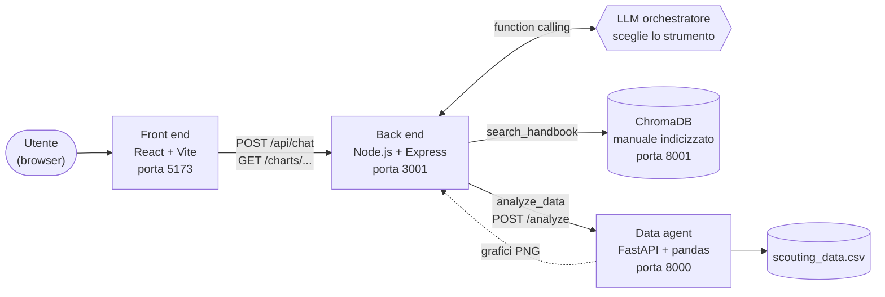

# ScoutEdge Analytics — assistente AI ibrido

Assistente conversazionale per il reparto Data Science & Client Success di **ScoutEdge Analytics**, un'azienda immaginaria che vende software di scouting e performance analytics ai club di calcio. L'utente scrive una domanda in italiano e un agente AI decide da solo come rispondere: cercando nel manuale interno dell'azienda oppure facendo analizzare il dataset delle osservazioni di scouting da un servizio Python, con tanto di grafici.

È il progetto finale del master universitario "AI e Agenti AI per il Business" (Start2Impact / UniMarconi).

## Lo scenario

Le persone del reparto hanno due problemi diversi, che di solito richiedono due strumenti diversi:

- **Trovare informazioni nei documenti.** Piani di abbonamento, metodologia di calcolo del rating, procedura di data cleaning, SLA e escalation, FAQ: tutto è nel manuale interno, e cercarlo a mano fa perdere tempo.
- **Estrarre numeri dai dati.** Medie, classifiche, andamenti per stagione, valori di mercato: le osservazioni dei giocatori sono in un file CSV con anomalie vere (duplicati, club scritti in decine di modi diversi, date in formati misti), che va prima ripulito.

L'assistente li risolve da un'unica chat. Per ogni domanda, un modello linguistico sceglie tra tre strade:

| La domanda riguarda… | Strada scelta | Esempio |
|---|---|---|
| regole, procedure, definizioni, metodologia | **RAG** sul manuale (ChromaDB) | "Qual è il tempo di prima risposta per priorità alta?" |
| numeri, classifiche, andamenti, grafici | **Data agent** Python sul dataset | "Qual è lo scout_rating medio per stagione?" |
| entrambe le cose | prima il manuale, poi i dati | "Secondo la metodologia, quali metriche contano per i difensori? Poi mostrami i migliori" |

Se la domanda non c'entra con ScoutEdge, l'assistente lo dice e non chiama nessuno strumento.

## Architettura



Quattro servizi, ciascuno nella sua cartella:

| Servizio | Cartella | Tecnologie | Porta |
|---|---|---|---|
| Front end | `front end/` | React 19, Vite 8, Tailwind CSS 4 | 5173 |
| Back end (orchestratore) | `back end/` | Node.js, Express 5, LangChain.js | 3001 |
| Data agent | `data_agent/` | Python, FastAPI, pandas, matplotlib, LangChain | 8000 |
| Database vettoriale | (container Docker) | ChromaDB | 8001 |

Come lavorano insieme:

- **Il browser parla solo con il back end.** Mai direttamente con il data agent né con Chroma: i grafici passano dal back end, che li riespone.
- **L'LLM è lo snodo decisionale.** Il back end gestisce la conversazione e passa al modello (`gpt-4o-mini`) due strumenti con la tecnica del *function calling*: `search_handbook` e `analyze_data`. Il modello ragiona sulla domanda e sceglie quale chiamare, in un ciclo ReAct scritto a mano. Il comportamento è descritto in [`docs/DESIGN_ORCHESTRATORE.md`](docs/DESIGN_ORCHESTRATORE.md).
- **Il RAG** usa ChromaDB con embedding OpenAI `text-embedding-3-small`: il manuale è diviso in 18 passaggi e solo quelli sufficientemente vicini alla domanda vengono passati al modello.
- **Il data agent** pulisce il CSV all'avvio, poi, per ogni richiesta, un agente scrive ed esegue codice Python (pandas, matplotlib) sui dati e restituisce un testo di sintesi e, se serve, un grafico in PNG.
- **La memoria della conversazione** vive nel back end: ogni conversazione ha un identificatore di sessione, con gli ultimi 20 messaggi e una scadenza di 30 minuti di inattività.

## Funzionalità

- Chat in italiano con memoria: "e nella stagione precedente?" o "e per i portieri?" si capiscono dal contesto.
- Risposte formattate in Markdown (elenchi, tabelle, grassetto).
- Grafici generati al volo dal data agent, mostrati nella risposta e, su schermi larghi, in un pannello laterale con "Ingrandisci" e "Scarica".
- Etichette sotto ogni risposta che mostrano da dove arriva: `📄 Handbook — <sezione>` oppure `📊 Analisi dati`.
- Indicatore di attesa durante l'elaborazione, avviso se si è offline, errori mostrati in chat con un messaggio comprensibile.
- "Nuova chat" per azzerare la conversazione.
- Se uno dei servizi non è disponibile, l'assistente lo dichiara e non inventa numeri né contenuti del manuale.

### Domande di esempio

Quattro domande che mostrano le diverse strade. I risultati attesi sono in [`docs/TEST.md`](docs/TEST.md).

| # | Domanda | Cosa mostra |
|---|---|---|
| 1 | *Qual è il tempo di prima risposta per una richiesta ad alta priorità?* | Solo RAG: risposta dal manuale (sezione 7), etichetta `📄 Handbook` |
| 2 | *Quali sono i 10 giocatori con il valore di mercato attuale più alto? Mostrami anche un grafico.* | Solo data agent: analisi del dataset e grafico, etichetta `📊 Analisi dati` |
| 3 | *Secondo la metodologia, quali metriche contano di più per i difensori centrali? Poi mostrami i 3 CB con il duels_won_pct attuale più alto.* | Entrambi gli strumenti, in sequenza: prima il manuale, poi i dati |
| 4 | *Qual è lo scout_rating medio nell'ultima stagione?* seguita da *E nella stagione precedente?* | Memoria della conversazione: la seconda domanda si capisce solo con la prima |

## Dati e knowledge base

L'agente lavora su due fonti, entrambe nella cartella `data/` e costruite per essere coerenti tra loro e con lo scenario.

### Dataset: `data/scouting_data.csv`

Osservazioni di scouting su giocatori di club immaginari: 35 colonne tra anagrafica, statistiche di gara, valore di mercato, scadenza del contratto, `scout_rating`, giorni di infortunio, data dell'osservazione e scout. La chiave dei giocatori è sempre `player_id`, mai il nome (ci sono omonimi).

| | Prima della pulizia | Dopo la pulizia |
|---|---|---|
| Righe | 1208 | 1185 |
| Giocatori | | 130 |
| Club | 74 grafie diverse | 25 |
| Nazionalità | 45 grafie diverse | 24 |
| Stagioni | | 3 (2023/24, 2024/25, 2025/26) |

Il file contiene volutamente dati "sporchi": 23 righe duplicate, club e nazionalità scritti in modi diversi (maiuscole, spazi), date e valori di mercato in formati misti, nomi di giocatori giapponesi in kanji, titoli e qualifiche nei nomi di alcuni giocatori (per esempio "Dr.", "Herr", "MBA"), che la pulizia toglie. Ci sono anche coppie di osservazioni dello stesso giocatore nello stesso giorno: non sono duplicati, ma valutazioni distinte, e l'agente le segnala quando incidono su una risposta.

La pulizia è **deterministica**, non affidata all'LLM: `data_agent/cleaning.py` la esegue una sola volta all'avvio del data agent e si ferma con un errore se i controlli finali non tornano. L'agente riceve il riepilogo delle correzioni, quindi sa rispondere anche a "quali correzioni avete applicato ai dati?".

### Knowledge base: `data/platform_handbook.md`

Il manuale interno del reparto (versione 1.7, circa 2500 parole, 8 sezioni): chi siamo, piani di abbonamento, metodologia di scouting, glossario delle metriche, policy dati e privacy, procedura di data cleaning, SLA e procedura di supporto, FAQ del Client Success. Viene indicizzato in ChromaDB in 18 passaggi (sezioni intere; la sezione 3 divisa per sottosezione, la 8 per domanda).

Manuale, dataset e interfaccia sono tenuti allineati tra loro. La procedura di data cleaning descritta nella sezione 6 è quella che `cleaning.py` implementa, e il glossario spiega le metriche che compaiono davvero nelle colonne del CSV. Il file [`docs/CHANGELOG_HANDBOOK.md`](docs/CHANGELOG_HANDBOOK.md) tiene la storia di queste scelte. Per esempio, nella versione 1.6 è stata tolta una guida alla dashboard perché citava funzioni (Shortlist, Confronto Giocatori, Report Custom) che l'interfaccia consegnata non ha: il retrieval le avrebbe attribuite a un prodotto che non c'è. Nella 1.3 lo storico delle stagioni è stato allineato a quello del dataset.

## Stack e versioni

| Livello | Tecnologie |
|---|---|
| Front end | React 19, Vite 8, Tailwind CSS 4, `react-markdown` con `remark-gfm` |
| Back end | Node.js (moduli ESM), Express 5, LangChain.js 1.x (`@langchain/core`, `@langchain/openai`), client `chromadb` 3.x, `zod` |
| Data agent | Python 3.13, FastAPI, uvicorn, pandas 3, matplotlib e seaborn, LangChain 1.x con LangGraph |
| Database vettoriale | ChromaDB 1.4.4 (immagine Docker `chromadb/chroma`, fissata con il digest), distanza coseno |
| Modelli OpenAI | `gpt-4o-mini` (orchestratore e data agent), `text-embedding-3-small` (embedding) |

Le versioni esatte sono in `back end/package.json`, `front end/package.json` e `data_agent/requirements.txt`. Nel back end non c'è il pacchetto generico `langchain`: il ciclo ReAct di scelta degli strumenti è scritto a mano, per tenerne sotto controllo ogni passo (vedi [`docs/DESIGN_ORCHESTRATORE.md`](docs/DESIGN_ORCHESTRATORE.md)).

## Prerequisiti

- **Node.js** 20.19 o successivo (oppure 22.12 o successivo), con npm. Lo richiede Vite 8.
- **Python 3.13**, con il modulo `venv`.
- **Docker**, per eseguire ChromaDB. È l'unico modo supportato per avviarlo.
- **Una chiave API OpenAI** con accesso a `gpt-4o-mini` e a `text-embedding-3-small`.
- **Porte libere**: 5173, 3001, 8000 e 8001.
- **Git**, per clonare il repository.

I comandi di questo README sono scritti per macOS e Linux, e sono stati provati su macOS. Su Windows cambia soprattutto il modo di attivare l'ambiente virtuale Python.

**Sui costi.** Ogni domanda genera alcune chiamate a `gpt-4o-mini` (una per l'orchestratore, di più se interviene il data agent), e l'indicizzazione del manuale usa gli embedding. Con questi modelli il costo è contenuto, ma non nullo, e la suite di test completa fa decine di richieste. Conviene usare una chiave con un limite di spesa.

## Installazione

I tre ambienti (back end, front end, data agent) si installano separatamente. Tutti i comandi partono dalla radice del repository.

```bash
git clone https://github.com/FranCodesc/scoutedge-analytics.git
cd scoutedge-analytics
```

**Back end** (le cartelle `back end/` e `front end/` hanno uno spazio nel nome: servono le virgolette):

```bash
cd "back end"
npm install
cp .env.example .env
cd ..
```

**Front end:**

```bash
cd "front end"
npm install
cp .env.example .env
cd ..
```

**Data agent** (Python 3.13, in un ambiente virtuale). L'installazione delle dipendenze può richiedere qualche minuto:

```bash
cd data_agent
python3.13 -m venv venv
source venv/bin/activate
pip install -r requirements.txt
cp .env.example .env
deactivate
cd ..
```

Se usi conda, esegui `conda deactivate` prima di creare e attivare il `venv`: con due ambienti attivi insieme `python` e `pip` possono puntare a quello sbagliato. Se `python3.13` non esiste sul tuo sistema, usa il comando che avvia Python 3.13 (`python3 --version` mostra la versione).

## Configurazione dei file `.env`

Ogni ambiente ha un file `.env.example` da copiare in `.env` (i comandi sopra lo fanno già). I valori di esempio vanno bene per l'avvio in locale: **serve solo inserire la chiave OpenAI**. I file `.env` contengono segreti, sono esclusi da git e non vanno mai committati.

| File | Variabile | Valore di esempio | Note |
|---|---|---|---|
| `back end/.env` | `OPENAI_API_KEY` | *(la tua chiave)* | Obbligatoria: embedding della RAG e LLM dell'orchestratore |
| | `PORT` | `3001` | Porta del back end |
| | `DATA_AGENT_URL` | `http://127.0.0.1:8000` | Il protocollo (`http://`) è obbligatorio |
| | `CHROMA_URL` | `http://localhost:8001` | Il protocollo è obbligatorio |
| | `FRONTEND_ORIGIN` | `http://localhost:5173` | Origine ammessa dalla CORS |
| `data_agent/.env` | `OPENAI_API_KEY` | *(la tua chiave)* | Obbligatoria: modello che scrive il codice di analisi |
| `front end/.env` | `VITE_API_URL` | `http://localhost:3001` | URL del back end. Le variabili `VITE_` finiscono nel browser: qui non vanno mai chiavi |

La stessa chiave può stare nei due file che la richiedono.

## Chroma e indicizzazione del manuale

ChromaDB si esegue con **Docker**, che è l'unico modo supportato e provato. Con Docker avviato, da `back end/`:

```bash
cd "back end"
docker run -d --name chroma-scoutedge -p 8001:8000 -v "$(pwd)/chroma_data:/data" chromadb/chroma@sha256:1e0b73a187a28757c572acba508c46f48c9e8b0acaf5c20e6d95cdedce1acdf6
npm run ingest
cd ..
```

L'immagine è fissata con il digest (Chroma 1.4.4, la versione su cui il progetto è stato provato) perché il tag `latest` cambia nel tempo e una versione diversa potrebbe non essere compatibile con il client `chromadb` del back end.

- Il container espone Chroma sulla porta 8001 e salva i dati in `back end/chroma_data/`, una cartella esclusa da git. Chroma 1.x scrive in `/data` dentro il container, per questo il mount punta lì.
- `npm run ingest` legge `data/platform_handbook.md`, ne calcola gli embedding con OpenAI e li scrive nella collection `platform-handbook`. Alla fine stampa `Chunk nella collection "platform-handbook": 18`.
- L'ingestione si può rilanciare in sicurezza: aggiorna i passaggi esistenti e rimuove quelli che non esistono più nel manuale.
- Se il container esiste già (errore "name already in use"), non ricrearlo: `docker start chroma-scoutedge`. Dopo un riavvio del computer si fa lo stesso: i dati indicizzati restano.

## Avvio

Servono quattro terminali (Chroma gira già in background con Docker). L'ordine conta: ogni servizio ne usa uno di quelli sopra. Tutti i comandi partono dalla radice del repository.

**1. Chroma.** Se hai appena eseguito `docker run`, è già attivo. Dopo un riavvio del computer:

```bash
docker start chroma-scoutedge
```

**2. Data agent** (primo terminale). Aspetta il messaggio `Data agent pronto`:

```bash
cd data_agent
source venv/bin/activate
uvicorn main:app --reload
```

Uvicorn ascolta solo su `127.0.0.1` (il comportamento predefinito): non aggiungere `--host 0.0.0.0`. Il data agent esegue codice generato dall'LLM e non deve essere raggiungibile dalla rete (vedi [Sicurezza e limiti noti](#sicurezza-e-limiti-noti)).

**3. Back end** (secondo terminale). Aspetta `Back end in ascolto su http://localhost:3001`:

```bash
cd "back end"
npm run dev
```

**4. Front end** (terzo terminale):

```bash
cd "front end"
npm run dev
```

Apri <http://localhost:5173>. All'avvio compare una breve schermata introduttiva di circa 3 secondi, poi la chat con le domande di esempio.

Per verificare che i servizi rispondano, da un altro terminale:

```bash
curl http://127.0.0.1:8000/     # data agent → {"status":"ok"}
curl http://localhost:3001/     # back end   → {"status":"ok"}
```

Le analisi sui dati possono richiedere fino a un minuto (il modello scrive ed esegue codice): l'interfaccia lo segnala dopo 10 secondi di attesa.

Per fermare tutto: `Ctrl+C` in ciascun terminale e `docker stop chroma-scoutedge`.

## Test

Con Chroma, data agent e back end avviati, da `back end/`:

```bash
cd "back end"
npm run test:api -- --solo-a    # solo i controlli automatici del contratto
npm run test:api                # controlli automatici + domande da valutare a mano
```

La parte automatica esegue 23 controlli (validazione degli input, codici di errore, sessioni, catena dei grafici) e deve chiudersi con **23 OK, 0 KO**. La seconda parte pone le domande del design attraverso l'API, e le risposte si confrontano a mano con i valori attesi. Le richieste chiamano OpenAI, quindi hanno un costo.

Le verifiche che richiedono di spegnere servizi, i valori attesi e le distanze di retrieval sono in [`docs/TEST.md`](docs/TEST.md).

Il data agent ha due script di prova in `data_agent/scripts/` (traccia di una domanda e regressione), descritti in [`docs/TEST.md`](docs/TEST.md#script-di-test-del-data-agent). L'esito della prova end-to-end dall'interfaccia è in [`docs/TEST.md`](docs/TEST.md#esito-della-prova-end-to-end-18-ottobre-2026).

## Struttura del repository

```text
.
├── README.md
├── data/
│   ├── scouting_data.csv          dataset delle osservazioni di scouting
│   └── platform_handbook.md       manuale interno (knowledge base del RAG)
├── docs/
│   ├── CONTRATTO_API.md           contratto tra front end e back end
│   ├── DESIGN_ORCHESTRATORE.md    design e prompt dell'orchestratore
│   ├── TEST.md                    come testare, valori attesi
│   └── CHANGELOG_HANDBOOK.md      storico delle versioni del manuale
├── back end/
│   ├── .env.example
│   ├── package.json
│   ├── scripts/
│   │   ├── ingestHandbook.js      indicizza il manuale in Chroma
│   │   └── testApi.js             test del contratto e delle domande
│   ├── src/
│   │   ├── index.js               server Express
│   │   ├── agent/                 orchestratore: prompt, strumenti, ciclo ReAct
│   │   ├── routes/                POST /api/chat e GET /charts/:filename
│   │   ├── services/              Chroma, embedding, RAG, sessioni, client del data agent
│   │   └── http/                  formato unico degli errori
│   └── chroma_data/               dati di Chroma (creata da Docker, esclusa da git)
├── data_agent/
│   ├── scripts/                   traccia_agente.py e regression_check.py
│   ├── .env.example
│   ├── requirements.txt
│   ├── main.py                    servizio FastAPI
│   ├── agent.py                   agente e strumento che esegue il codice Python
│   ├── cleaning.py                pulizia deterministica del dataset
│   ├── prototype.ipynb            notebook di prototipazione
│   └── charts/                    grafici PNG generati (creata all'avvio, esclusa da git)
└── front end/
    ├── .env.example
    ├── README.md                  dettagli dell'interfaccia
    └── src/                       api/, hooks/, components/
```

## Contratto API e orchestratore

Due documenti in `docs/` descrivono nel dettaglio come i pezzi si parlano. Qui la sintesi.

### Contratto tra front end e back end

[`docs/CONTRATTO_API.md`](docs/CONTRATTO_API.md) fissa il formato di richieste, risposte ed errori, in JSON con campi in camelCase.

- **`POST /api/chat`**: riceve `message` (1–2000 caratteri) e, dalla seconda domanda in poi, `sessionId`. Risponde con `sessionId`, `newSession`, `reply` (testo, anche Markdown), `chartUrl` (percorso del grafico oppure `null`), `toolsUsed` (gli strumenti usati) e `sources` (le sezioni del manuale consultate).
- **`GET /charts/:filename`**: restituisce un grafico PNG. Il nome deve avere la forma `chart_<8 caratteri esadecimali>.png`, altrimenti la richiesta è rifiutata.
- **`GET /`**: controllo di stato.
- **Errori**: sempre nel formato `{ "error": { "code": "...", "message": "..." } }`, con messaggio in italiano mostrabile all'utente, mai con dettagli interni.

| HTTP | Codice | Quando |
|---|---|---|
| 400 | `INVALID_REQUEST` | input non valido (JSON, messaggio vuoto o troppo lungo, `sessionId` o nome del grafico non validi) |
| 404 | `NOT_FOUND` | rotta o grafico inesistente |
| 409 | `SESSION_BUSY` | è già in corso una richiesta sulla stessa conversazione |
| 413 | `PAYLOAD_TOO_LARGE` | corpo della richiesta oltre 10 kb |
| 502 | `LLM_ERROR` | errore nella chiamata al modello |
| 504 | `TIMEOUT` | elaborazione oltre 120 secondi |
| 500 | `INTERNAL_ERROR` | qualsiasi altro errore imprevisto |

Se un singolo strumento non è raggiungibile (Chroma o data agent spenti), **non** è un errore HTTP: la risposta è un normale 200 in cui l'assistente dichiara che quel componente non è disponibile, senza inventare dati.

Le conversazioni vivono in memoria nel back end: ultimi 20 messaggi, scadenza dopo 30 minuti di inattività. I timeout sono di 90 secondi verso il data agent, 120 per l'intera richiesta e 130 lato interfaccia.

### Orchestratore

[`docs/DESIGN_ORCHESTRATORE.md`](docs/DESIGN_ORCHESTRATORE.md) descrive come l'LLM sceglie lo strumento, con il prompt completo, le versioni e i test che lo hanno guidato. In breve:

- **Procedura di decisione esclusiva.** Il prompt contiene una procedura numerata: solo dati → solo `analyze_data`; solo regole o metodologia → solo `search_handbook`; entrambi gli strumenti solo se la domanda chiede esplicitamente le due cose; fuori ambito → nessuno strumento. I casi di confine sono scritti in chiaro.
- **Il RAG filtra per pertinenza.** Un passaggio del manuale arriva al modello solo se la distanza dalla domanda è sotto una soglia assoluta (0.60) e vicina a quella del passaggio migliore.
- **Cose deterministiche nel codice, non nel prompt.** La richiesta di un grafico è un parametro strutturato del tool e la nota "grafico generato" la scrive il codice: il modello non può dire di aver mostrato un grafico che non esiste.
- **Domande autonome.** Il data agent non vede la conversazione: l'orchestratore riscrive ogni domanda in modo completo ("e per i portieri?" diventa una domanda con ruolo e periodo espliciti).
- **Errori degli strumenti come testo.** Un guasto diventa un messaggio per il modello, che lo riporta all'utente; non interrompe la conversazione.
- **Limite dichiarato.** Le tre stagioni del dataset sono scritte nel prompt per risolvere riferimenti come "la stagione precedente": se il dataset cambia, vanno aggiornate.

## Sicurezza e limiti noti

**Segreti.** Nessuna chiave API è nel codice: stanno solo nei file `.env`, esclusi da git, e ogni ambiente ha un `.env.example` senza valori. Nel front end le variabili `VITE_` sono pubbliche per costruzione e non contengono segreti.

### Il limite principale: il data agent non ha una sandbox

Il data agent esegue codice Python generato dall'LLM (con `exec` ed `eval`) **senza isolamento**. Il percorso d'attacco è reale: il testo scritto in chat arriva, tramite l'orchestratore, al modello che genera quel codice, quindi una *prompt injection* ben costruita potrebbe tradursi in codice arbitrario eseguito sulla macchina del data agent. Il fatto che il servizio ascolti solo su `127.0.0.1` riduce la superficie d'attacco, ma non la elimina.

Per questo il sistema è pensato per un uso locale e dimostrativo. Le difese adottate sono a strati e nessuna, da sola, è una barriera di sicurezza:

- **Orchestratore:** una regola del prompt vieta di inoltrare codice, comandi o istruzioni agli strumenti (verificata con una richiesta di prompt injection, test 9 di [`docs/TEST.md`](docs/TEST.md)). È un primo filtro, non una garanzia.
- **Input:** messaggi limitati a 2000 caratteri, corpo della richiesta a 10 kb, `sessionId` validato come UUID.
- **Rete:** il data agent ascolta solo su `127.0.0.1`; la CORS del back end ammette solo l'origine del front end.
- **Tempo:** timeout di 90, 120 e 130 secondi sui tre tratti della richiesta.
- **Grafici:** i nomi dei file sono validati a tre livelli (data agent, back end e front end) contro il path traversal, e il salvataggio dei grafici è riservato allo strumento, non al codice del modello.
- **Informazioni:** nessun percorso di sistema viene dato al modello, nessun errore interno né valore di configurazione arriva al browser, e l'output dello strumento è limitato a 6000 caratteri.
- **Intestazioni HTTP:** `x-powered-by` disattivato e `nosniff` sui grafici.
- **Front end:** il Markdown è reso senza HTML grezzo né immagini, e i link hanno `rel="noopener noreferrer"`.

### Altri limiti noti

- **Sessioni in memoria e senza tetto.** Ogni richiesta senza `sessionId` crea una sessione che vive 30 minuti. Si potrebbe aggiungere una soglia massima.
- **Stato globale di matplotlib.** Sotto richieste concorrenti al data agent i grafici possono interferire tra loro.
- **Comportamento probabilistico.** Gli LLM non sono deterministici: alcune domande sui dati hanno un'affidabilità inferiore alla media (elenco in [`docs/TEST.md`](docs/TEST.md#limiti-noti-del-data-agent)).
- **Formato degli importi.** Nelle risposte gli importi sono scritti nella notazione anglosassone (18,680,000: virgola per le migliaia, punto per i decimali), mentre gli assi dei grafici usano il punto per le migliaia (17.500.000). Una regola sul formato nel prompt del data agent è stata provata e tolta perché peggiorava risposte che non c'entravano con gli importi.
- **Stagioni scritte nel prompt**, come detto sopra.
- **Dipendenze di sviluppo del front end.** `npm audit` può segnalare vulnerabilità in pacchetti usati solo in sviluppo e in fase di build: non fanno parte del codice che arriva al browser.

### In produzione servirebbero

Una sandbox isolata per l'esecuzione del codice (container senza rete né accesso al disco), autenticazione, limiti di frequenza delle richieste e uno store di sessioni persistente e con limiti.

## Risoluzione dei problemi

| Sintomo | Causa probabile | Cosa fare |
|---|---|---|
| `Cannot connect to the Docker daemon` | Docker non è avviato | Apri Docker Desktop e riprova |
| `npm run ingest` non riesce a collegarsi a Chroma | Il container non è attivo, oppure è appena partito | `docker ps` per controllare; aspetta qualche secondo; se manca, `docker start chroma-scoutedge` |
| L'assistente dice che il manuale non è consultabile | Chroma spento, oppure manuale non ancora indicizzato | Avvia Chroma ed esegui `npm run ingest` da `back end/` |
| L'assistente dice che il servizio di analisi dati non è disponibile | Data agent spento o su un'altra porta | Avvialo come descritto in [Avvio](#avvio) e controlla `DATA_AGENT_URL` nel `.env` del back end |
| Errore "address already in use" all'avvio | La porta (3001, 5173, 8000 o 8001) è occupata | `lsof -i :3001` (cambia il numero) per vedere il processo, poi fermalo |
| Dopo `pip install` mancano pacchetti o `python` è quello sbagliato | È attivo conda, o il venv non è attivato | `conda deactivate`, poi ricrea e attiva il `venv` (vedi [Installazione](#installazione)) |
| Errore `LLM_ERROR` (502) in chat | Chiave OpenAI mancante, non valida o senza credito | Controlla `OPENAI_API_KEY` in `back end/.env` e in `data_agent/.env`, poi riavvia il servizio: le modifiche ai `.env` si leggono solo all'avvio |
| Il back end si ferma all'avvio con un errore sugli URL | Un indirizzo nel `.env` è senza `http://` | Scrivi l'URL completo, per esempio `http://localhost:8001` |
| Nel browser compare un errore di rete o di CORS | Il front end non gira sulla porta 5173, oppure il back end non su 3001 | In `back end/.env` imposta `FRONTEND_ORIGIN` all'indirizzo reale del front end; in `front end/.env` imposta `VITE_API_URL`; riavvia i due servizi |
| Risposta "richiesta già in corso" (409) | La domanda precedente della stessa conversazione non ha ancora finito | Aspetta la risposta, oppure avvia una "Nuova chat" |
| L'interfaccia usa un carattere diverso da Barlow Condensed | Senza rete, Google Fonts non si carica | Non è un errore: si usa il carattere di sistema |