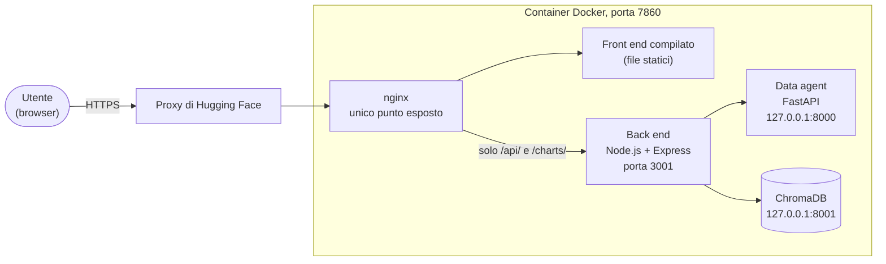

# Demo online e deploy

La demo è pubblica all'indirizzo <https://francodesc-scoutedge-analytics.hf.space>, su uno Space Docker di Hugging Face. Esegue lo stesso codice del repository, impacchettato in un unico container.

Lo Space va in pausa dopo 48 ore senza visite. Alla prima apertura dopo una pausa la demo riparte in circa 30 secondi. Le conversazioni e i grafici generati non sopravvivono al riavvio: le sessioni stanno in memoria e il manuale viene indicizzato di nuovo a ogni avvio.

## Architettura del container



- **nginx è l'unico processo raggiungibile dall'esterno** (porta 7860). Serve il front end già compilato e inoltra al back end solo `/api/` e `/charts/`. Tutto il resto dà 404, compreso il controllo di stato `GET /` del back end.
- Il back end ascolta sulla porta 3001 di tutte le interfacce del container, ma la porta non è pubblicata: si raggiunge solo tramite nginx. Data agent e Chroma ascoltano solo su `127.0.0.1`.
- Cinque processi, avviati da `deploy/start.sh` nell'ordine in cui dipendono l'uno dall'altro: Chroma, indicizzazione del manuale (18 passaggi), data agent, back end, nginx. Lo script aspetta ogni servizio fino a 120 secondi e, se uno si ferma, chiude il container con un codice diverso da 0, così la piattaforma lo riavvia.
- Il container gira con un utente non root (UID 1000). Il codice appartiene a root e l'utente può scrivere solo nella cartella dei grafici e in `/tmp`, dove stanno i dati di Chroma.
- Nell'immagine non c'è nessun segreto: i file `.env` sono esclusi da `.dockerignore`, e la chiave e le altre variabili si passano all'avvio.
- L'immagine occupa 1,96 GB su disco (406 MB compressi) e il container usa tra 212 e 256 MB di memoria.

## Avvio in locale con Docker

Serve solo Docker. Non servono Node.js né Python, e nemmeno gli altri servizi dell'[installazione in locale](INSTALLAZIONE.md).

**1. File di variabili**, **fuori dal repository** (per esempio nella cartella home), con un nome come `scoutedge-container.env`. Una variabile per riga, senza virgolette:

```text
OPENAI_API_KEY=<la tua chiave>
FRONTEND_ORIGIN=http://localhost:7860
RATE_LIMIT_WINDOW_MIN=15
RATE_LIMIT_PER_IP=20
RATE_LIMIT_GLOBAL=100
TRUST_PROXY=1
```

Sono le sei variabili che lo script di avvio richiede: se ne manca una, il container si ferma subito e dice quale (senza mai stamparne il valore). In locale c'è un solo proxy davanti al back end, nginx, per questo `TRUST_PROXY` è `1`.

**2. Build**, dalla radice del repository. `VITE_API_URL` è l'indirizzo con cui il browser raggiunge il back end e Vite lo incorpora nel codice al momento della build. Non ha un valore predefinito: senza l'argomento la build si ferma con `Manca --build-arg VITE_API_URL`.

```bash
docker build --build-arg VITE_API_URL=http://localhost:7860 -t scoutedge .
```

**3. Avvio.** La porta è pubblicata solo su `127.0.0.1`:

```bash
docker run --rm --name scoutedge -p 127.0.0.1:7860:7860 --env-file ~/scoutedge-container.env scoutedge
```

Quando il log mostra `[avvio] Tutti i servizi sono attivi.` (circa 20 secondi), apri <http://localhost:7860>. Usa esattamente questo indirizzo, lo stesso della build: con `127.0.0.1` al posto di `localhost` il browser lo tratterebbe come un'origine diversa e la CORS bloccherebbe le richieste. Per cambiare indirizzo, rifai la build con un altro `VITE_API_URL` e aggiorna `FRONTEND_ORIGIN`. Per fermare: `Ctrl+C`, oppure `docker stop scoutedge` da un altro terminale.

Per provare il limite di frequenza in locale basta abbassare i valori nel file (per esempio `RATE_LIMIT_PER_IP=3`). Le prove fatte sono in [`docs/TEST.md`](TEST.md#prove-del-limite-di-frequenza-in-locale).

## Pubblicazione su Hugging Face

**Prerequisiti.** Un account Hugging Face con il piano PRO (vedi [Scelta della piattaforma](#scelta-della-piattaforma)), lo strumento `hf` (`pip install -U huggingface_hub`) e l'accesso già effettuato con `hf auth login`, meglio con un token a granularità fine limitato allo Space. Lo Space è di tipo Docker, creato dall'interfaccia web (nella demo: `FranCodesc/scoutedge-analytics`, CPU basic, pubblico).

**Secret e variabili dello Space** (scheda *Settings* → *Variables and secrets*):

| Tipo | Nome | Valore |
|---|---|---|
| Secret | `OPENAI_API_KEY` | una chiave OpenAI dedicata alla demo, con un tetto di spesa mensile |
| Variabile | `VITE_API_URL` | l'URL pubblico dello Space (arriva alla build come argomento, perché il `Dockerfile` lo dichiara con `ARG`) |
| Variabile | `FRONTEND_ORIGIN` | l'URL pubblico dello Space |
| Variabili | `RATE_LIMIT_WINDOW_MIN`, `RATE_LIMIT_PER_IP`, `RATE_LIMIT_GLOBAL` | `15`, `20`, `100` |
| Variabile | `TRUST_PROXY` | `2` |

Le variabili di uno Space sono pubbliche: per questo la chiave sta tra i secret e nelle variabili ci sono solo valori che non sono segreti.

**Caricamento.** Prima si pubblica il commit su GitHub, poi lo si carica sullo Space, così i due restano allo stesso commit:

```bash
git push
deploy/upload_space.sh FranCodesc/scoutedge-analytics --prova   # elenca i file, non carica nulla
deploy/upload_space.sh FranCodesc/scoutedge-analytics           # carica
```

Lo script:

- parte da `git archive HEAD`, quindi carica **solo i file committati**: `.env`, `venv/`, `node_modules/` e le modifiche non ancora committate non possono finire sullo Space (se ci sono modifiche non committate, lo script avvisa);
- sostituisce il `README.md` del repository con `deploy/README_SPACE.md`, che ha l'intestazione di configurazione che lo Space legge (SDK Docker, porta 7860);
- si rifiuta di caricare se l'esportazione contiene file vietati (`.env*` tranne `.env.example`, `venv`, `node_modules`, `chroma_data`, `.git`);
- usa `hf upload`, che aggiunge e sovrascrive file ma **non cancella** sullo Space quelli tolti dal repository: vanno rimossi a mano.

Dopo il caricamento lo Space ricostruisce l'immagine (circa 1 minuto) e riavvia il container.

## `TRUST_PROXY`: come è stato ricavato

Il limite di frequenza per IP funziona solo se il back end conosce l'IP vero di chi scrive. Dietro una catena di proxy l'IP sta nell'intestazione `X-Forwarded-For`, e `TRUST_PROXY` dice a Express quanti proxy della catena sono fidati. Un valore sbagliato si sbaglia in due modi: troppo basso e il limite vede solo indirizzi dei proxy; troppo alto e ci si fida di un'intestazione che il client può scrivere da solo.

Online la catena è: proxy di Hugging Face, poi nginx, poi back end. Il valore si è ricavato provando, non assumendolo:

- con `TRUST_PROXY=1` il limite vedeva indirizzi interni di Hugging Face (`10.20.x.x`), diversi a ogni richiesta: ogni richiesta contava come un client nuovo;
- con `TRUST_PROXY=2` il limite vede l'IP pubblico del computer da cui si provava;
- **prova di falsificazione:** inviando una richiesta con l'intestazione `X-Forwarded-For: 1.2.3.4` scritta a mano, l'indirizzo falsificato viene ignorato: resta più a sinistra nella catena e non è quello usato per il limite.

Senza `TRUST_PROXY` il back end ignora del tutto `X-Forwarded-For`. Il numero giusto dipende dalla piattaforma: su un altro servizio va ricavato di nuovo con la stessa prova.

## Scelta della piattaforma

Il progetto è stato pubblicato su uno **Space Docker di Hugging Face**, che dall'8 luglio 2026 richiede il piano PRO (9 $/mese). Il container in funzione usa tra 212 e 256 MB: con un limite di 256 MB non c'è margine, con 512 MB sì. Perché questa piattaforma e non un piano gratuito, con la simulazione delle risorse ridotte, è spiegato in [decisions/08](decisions/08-deploy-su-hugging-face-spaces.md); le misure sono in [`docs/TEST.md`](TEST.md#simulazione-con-risorse-ridotte) e le prove online in [`docs/TEST.md`](TEST.md#prove-online-26-ottobre-2026).

**Il container non dipende dalla piattaforma.** Qualunque servizio che esegue un container Docker e permette di impostare variabili d'ambiente può ospitarlo: le variabili sono quelle della tabella sopra, e va ricavato di nuovo `TRUST_PROXY`.
