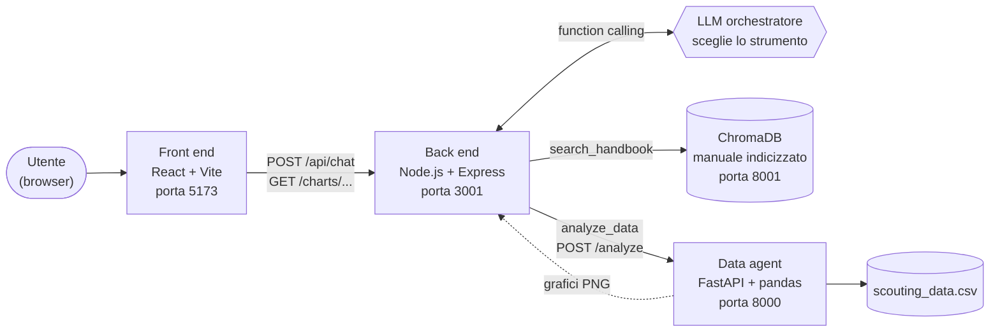

# Il progetto

Scenario, architettura, funzionalità, dati e struttura del repository di ScoutEdge Analytics. Per installarlo e avviarlo in locale vedi [`docs/INSTALLAZIONE.md`](INSTALLAZIONE.md); per la demo online [`docs/DEPLOY.md`](DEPLOY.md).

## Lo scenario

Le persone del reparto hanno due problemi diversi, che di solito richiedono due strumenti diversi:

- **Trovare informazioni nei documenti.** Piani di abbonamento, metodologia di calcolo del rating, procedura di data cleaning, SLA e escalation, FAQ: tutto è nel manuale interno, e cercarlo a mano fa perdere tempo.
- **Estrarre numeri dai dati.** Medie, classifiche, andamenti per stagione, valori di mercato: le osservazioni dei giocatori sono in un file CSV con anomalie vere (duplicati, club scritti in decine di modi diversi, date in formati misti), che va prima ripulito.

L'assistente li risolve da un'unica chat. Per ogni domanda, un modello linguistico sceglie tra tre strade:

| La domanda riguarda… | Strada scelta | Esempio |
|---|---|---|
| regole, procedure, definizioni, metodologia | **RAG** sul manuale (ChromaDB) | "Qual è il tempo di prima risposta per priorità alta?" |
| numeri, classifiche, andamenti, grafici | **Data agent** Python sul dataset | "Qual è lo scout_rating medio per stagione?" |
| entrambe le cose | prima il manuale, poi i dati | "Secondo la metodologia, quali metriche contano per i difensori? Poi mostrami i migliori" |

Se la domanda non c'entra con ScoutEdge, l'assistente lo dice e non chiama nessuno strumento.

## Architettura



Quattro servizi, ciascuno nella sua cartella:

| Servizio | Cartella | Tecnologie | Porta |
|---|---|---|---|
| Front end | `front end/` | React 19, Vite 8, Tailwind CSS 4 | 5173 |
| Back end (orchestratore) | `back end/` | Node.js, Express 5, LangChain.js | 3001 |
| Data agent | `data_agent/` | Python, FastAPI, pandas, matplotlib, LangChain | 8000 |
| Database vettoriale | (container Docker) | ChromaDB | 8001 |

Come lavorano insieme:

- **Il browser parla solo con il back end.** Mai direttamente con il data agent né con Chroma: i grafici passano dal back end, che li riespone.
- **L'LLM è lo snodo decisionale.** Il back end gestisce la conversazione e passa al modello (`gpt-4o-mini`) due strumenti con la tecnica del *function calling*: `search_handbook` e `analyze_data`. Il modello ragiona sulla domanda e sceglie quale chiamare, in un ciclo ReAct scritto a mano. Il comportamento è descritto in [`docs/DESIGN_ORCHESTRATORE.md`](DESIGN_ORCHESTRATORE.md).
- **Il RAG** usa ChromaDB con embedding OpenAI `text-embedding-3-small`: il manuale è diviso in 18 passaggi e solo quelli sufficientemente vicini alla domanda vengono passati al modello.
- **Il data agent** pulisce il CSV all'avvio, poi, per ogni richiesta, un agente scrive ed esegue codice Python (pandas, matplotlib) sui dati e restituisce un testo di sintesi e, se serve, un grafico in PNG.
- **La memoria della conversazione** vive nel back end: ogni conversazione ha un identificatore di sessione, con gli ultimi 20 messaggi e una scadenza di 30 minuti di inattività.

Questo è lo schema dell'avvio in locale, con quattro processi separati. Nella demo online gli stessi servizi girano in un solo container, dietro nginx: vedi [`docs/DEPLOY.md`](DEPLOY.md).

## Funzionalità

- Chat in italiano con memoria: "e nella stagione precedente?" o "e per i portieri?" si capiscono dal contesto.
- Risposte formattate in Markdown (elenchi, tabelle, grassetto).
- Grafici generati al volo dal data agent, mostrati nella risposta e, su schermi larghi (da 1024 px), in un pannello laterale con "Ingrandisci" e "Scarica". Il grafico del pannello si ingrandisce anche con un clic.
- Se l'immagine di un grafico non si carica (file non più disponibile o servizio spento), al suo posto compare un testo di riserva, anche nel pannello e nella finestra di ingrandimento.
- Etichette sotto ogni risposta che mostrano da dove arriva: `📄 Handbook — <sezione>` per ogni sezione del manuale citata, `📊 Analisi dati`, oppure `📄 Handbook (nessuna sezione citata)` quando il manuale è stato consultato ma non c'è nessuna sezione da citare (nessun passaggio abbastanza pertinente, oppure Chroma non raggiungibile).
- Quattro schede di esempio nella schermata iniziale: un clic invia la domanda.
- Pulsante "Note" in alto: apre la finestra "Note sul progetto", con una breve descrizione del progetto, dell'architettura e dei limiti, e l'autore.
- Indicatore di attesa durante l'elaborazione, con un avviso dopo 10 secondi se la risposta tarda; avviso se si è offline.
- Errori mostrati in chat con un messaggio comprensibile e, quando ritentare ha senso, il pulsante "Riprova".
- "Nuova chat" per azzerare la conversazione.
- Se uno dei servizi non è disponibile, l'assistente lo dichiara e non inventa numeri né contenuti del manuale.

### Domande di esempio

Quattro domande che mostrano le diverse strade. I risultati attesi sono in [`docs/TEST.md`](TEST.md).

| # | Domanda | Cosa mostra |
|---|---|---|
| 1 | *Qual è il tempo di prima risposta per una richiesta ad alta priorità?* | Solo RAG: risposta dal manuale (sezione 7), etichetta `📄 Handbook — 7. SLA e procedura di supporto` |
| 2 | *Quali sono i 10 giocatori con il valore di mercato attuale più alto? Mostrami anche un grafico.* | Solo data agent: analisi del dataset e grafico, etichetta `📊 Analisi dati` |
| 3 | *Secondo la metodologia, quali metriche contano di più per i difensori centrali? Poi mostrami i 3 CB con il duels_won_pct attuale più alto.* | Entrambi gli strumenti, in sequenza: prima il manuale, poi i dati |
| 4 | *Qual è lo scout_rating medio nell'ultima stagione?* seguita da *E nella stagione precedente?* | Memoria della conversazione: la seconda domanda si capisce solo con la prima |

## Dati e knowledge base

L'agente lavora su due fonti, entrambe nella cartella `data/` e costruite per essere coerenti tra loro e con lo scenario.

### Dataset: `data/scouting_data.csv`

Osservazioni di scouting su giocatori di club immaginari: 35 colonne tra anagrafica, statistiche di gara, valore di mercato, scadenza del contratto, `scout_rating`, giorni di infortunio, data dell'osservazione e scout. La chiave dei giocatori è sempre `player_id`, mai il nome (ci sono omonimi).

| | Prima della pulizia | Dopo la pulizia |
|---|---|---|
| Righe | 1208 | 1185 |
| Giocatori | | 130 |
| Club | 74 grafie diverse | 25 |
| Nazionalità | 45 grafie diverse | 24 |
| Stagioni | | 3 (2023/24, 2024/25, 2025/26) |

Il file contiene volutamente dati "sporchi": 23 righe duplicate, club e nazionalità scritti in modi diversi (maiuscole, spazi), date e valori di mercato in formati misti, nomi di giocatori giapponesi in kanji, titoli e qualifiche nei nomi di alcuni giocatori (per esempio "Dr.", "Herr", "MBA"), che la pulizia toglie. Ci sono anche coppie di osservazioni dello stesso giocatore nello stesso giorno: non sono duplicati, ma valutazioni distinte, e l'agente le segnala quando incidono su una risposta.

La pulizia è **deterministica**, non affidata all'LLM: `data_agent/cleaning.py` la esegue una sola volta all'avvio del data agent, poi `data_agent/schema.py` controlla le colonne del CSV grezzo e, sul dataframe pulito, tipi, intervalli di plausibilità, domini chiusi, valori mancanti e relazioni tra colonne: se trova violazioni le elenca tutte in un solo errore e il servizio non parte ([decisions/05](decisions/05-pulizia-e-schema-dei-dati.md)). L'agente riceve il riepilogo delle correzioni, quindi sa rispondere anche a "quali correzioni avete applicato ai dati?".

### Knowledge base: `data/platform_handbook.md`

Il manuale interno del reparto (versione 1.7, circa 2500 parole, 8 sezioni): chi siamo, piani di abbonamento, metodologia di scouting, glossario delle metriche, policy dati e privacy, procedura di data cleaning, SLA e procedura di supporto, FAQ del Client Success. Viene indicizzato in ChromaDB in 18 passaggi (sezioni intere; la sezione 3 divisa per sottosezione, la 8 per domanda).

Manuale, dataset e interfaccia sono tenuti allineati tra loro. La procedura di data cleaning descritta nella sezione 6 è quella che `cleaning.py` implementa, e il glossario spiega le metriche che compaiono davvero nelle colonne del CSV. Il file [`docs/CHANGELOG_HANDBOOK.md`](CHANGELOG_HANDBOOK.md) tiene la storia di queste scelte. Per esempio, nella versione 1.6 è stata tolta una guida alla dashboard perché citava funzioni (Shortlist, Confronto Giocatori, Report Custom) che l'interfaccia consegnata non ha: il retrieval le avrebbe attribuite a un prodotto che non c'è. Nella 1.3 lo storico delle stagioni è stato allineato a quello del dataset.

## Stack e versioni

| Livello | Tecnologie |
|---|---|
| Front end | React 19, Vite 8, Tailwind CSS 4, `react-markdown` con `remark-gfm` |
| Back end | Node.js (moduli ESM), Express 5, LangChain.js 1.x (`@langchain/core`, `@langchain/openai`), client `chromadb` 3.x, `zod` 4, `express-rate-limit` 8 |
| Data agent | Python 3.13, FastAPI, uvicorn, pandas 3, matplotlib e seaborn, LangChain 1.x con LangGraph |
| Database vettoriale | ChromaDB 1.4.4 (immagine Docker `chromadb/chroma`, fissata con il digest), distanza coseno |
| Modelli OpenAI | `gpt-4o-mini` (orchestratore e data agent), `text-embedding-3-small` (embedding) |
| Deploy | Docker (immagine in tre fasi: `node:24-trixie-slim`, `chromadb/chroma` fissata con il digest, `python:3.13-slim-trixie`), nginx (pacchetto di Debian trixie), Hugging Face Spaces |
| Test e CI | pytest (data agent), `node:test` (back end), Vitest con jsdom e Testing Library (front end), GitHub Actions (Python 3.13, Node 24) |

Le versioni esatte sono in `back end/package.json`, `front end/package.json` e `data_agent/requirements.txt` (strumenti di sviluppo e test in `data_agent/requirements-dev.txt`). Nel back end non c'è il pacchetto generico `langchain`: il ciclo ReAct di scelta degli strumenti è scritto a mano, per tenerne sotto controllo ogni passo (vedi [`docs/DESIGN_ORCHESTRATORE.md`](DESIGN_ORCHESTRATORE.md)).

## Struttura del repository

```text
.
├── README.md
├── Dockerfile                     container unico della demo online
├── .dockerignore                  file esclusi dall'immagine
├── .github/workflows/test.yml     test automatici a ogni push e pull request
├── deploy/
│   ├── nginx.conf                 nginx: unico punto esposto del container
│   ├── start.sh                   avvio dei servizi nel container
│   ├── upload_space.sh            caricamento dei file committati sullo Space
│   └── README_SPACE.md            README dello Space (con la sua intestazione)
├── data/
│   ├── scouting_data.csv          dataset delle osservazioni di scouting
│   └── platform_handbook.md       manuale interno (knowledge base del RAG)
├── docs/
│   ├── PROGETTO.md                scenario, funzionalità, dati, architettura (questo file)
│   ├── INSTALLAZIONE.md           installazione, file .env, avvio in locale, Windows
│   ├── DEPLOY.md                  demo online: container, Docker in locale, Hugging Face
│   ├── SICUREZZA.md               sicurezza e limiti noti
│   ├── PROBLEMI.md                risoluzione dei problemi
│   ├── CONTRATTO_API.md           contratto tra front end e back end
│   ├── DESIGN_ORCHESTRATORE.md    design e prompt dell'orchestratore
│   ├── TEST.md                    test automatici, valutazione, verifiche, valori attesi
│   ├── CHANGELOG_HANDBOOK.md      storico delle versioni del manuale
│   ├── decisions/                 storia e motivazioni delle scelte principali
│   └── ScoutEdge_Analytics_presentazione.pdf   presentazione (18 slide)
├── back end/
│   ├── .env.example
│   ├── package.json
│   ├── scripts/
│   │   ├── ingestHandbook.js      indicizza il manuale in Chroma
│   │   └── testApi.js             test del contratto e delle domande
│   ├── src/
│   │   ├── index.js               avvio del server (variabili d'ambiente)
│   │   ├── app.js                 costruzione dell'app Express, con dipendenze iniettabili
│   │   ├── agent/                 orchestratore: prompt, strumenti, ciclo ReAct
│   │   ├── routes/                POST /api/chat e GET /charts/:filename
│   │   ├── services/              Chroma, embedding, RAG, sessioni, client del data agent
│   │   └── http/                  formato unico degli errori e limite di frequenza
│   ├── test/                      test automatici (node:test)
│   ├── eval/                      valutazione automatica con il modello reale, con i risultati
│   └── chroma_data/               dati di Chroma (creata da Docker, esclusa da git)
├── data_agent/
│   ├── .env.example
│   ├── requirements.txt           dipendenze del servizio
│   ├── requirements-dev.txt       dipendenze di sviluppo e test
│   ├── pytest.ini                 configurazione dei test
│   ├── main.py                    servizio FastAPI
│   ├── agent.py                   agente e strumento che esegue il codice Python
│   ├── cleaning.py                pulizia deterministica del dataset
│   ├── schema.py                  schema dei dati, controllato all'avvio
│   ├── prototype.ipynb            notebook di prototipazione
│   ├── tests/                     test automatici (pytest)
│   ├── scripts/                   traccia, regressione e benchmark, con i risultati
│   └── charts/                    grafici PNG generati (creata all'avvio, esclusa da git)
└── front end/
    ├── .env.example
    ├── README.md                  dettagli dell'interfaccia
    ├── vitest.config.js           configurazione dei test
    ├── src/                       api/, hooks/, components/
    └── test/                      test automatici (Vitest)
```

Per i dettagli dell'interfaccia (componenti, scelte tecniche, script) vedi [`front end/README.md`](../front%20end/README.md).

## Contratto API e orchestratore

Due documenti descrivono nel dettaglio come i pezzi si parlano:

- [`docs/CONTRATTO_API.md`](CONTRATTO_API.md): formato di richieste, risposte ed errori tra front end e back end, sessioni, limite di frequenza e timeout.
- [`docs/DESIGN_ORCHESTRATORE.md`](DESIGN_ORCHESTRATORE.md): come l'LLM sceglie lo strumento, con il prompt completo, le versioni e i test che lo hanno guidato.

Il perché delle scelte principali, con le alternative scartate, è in [`docs/decisions/`](decisions/README.md).
